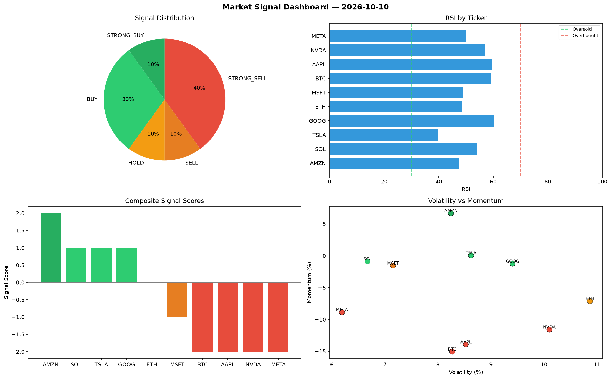

# Market Signal Report — 2026-10-10

**Run ID:** `69a612b1d1` | **Buy:** 4 | **Sell:** 5 | **Hold:** 1

## Signal Dashboard

| Ticker | Price | Signal | Score | RSI | Momentum | Confidence |
|--------|-------|--------|-------|-----|----------|------------|
| AMZN | $2846.8 | **STRONG_BUY** | 2 | 47.47 | 0.0669 | 0.5 |
| SOL | $2046.27 | **BUY** | 1 | 54.14 | -0.0088 | 0.25 |
| TSLA | $1442.59 | **BUY** | 1 | 39.93 | 0.0006 | 0.25 |
| GOOG | $783.08 | **BUY** | 1 | 60.15 | -0.0124 | 0.25 |
| ETH | $211.26 | **HOLD** | 0 | 48.45 | -0.0711 | 0.0 |
| MSFT | $286.13 | **SELL** | -1 | 48.92 | -0.0154 | 0.25 |
| BTC | $2103.32 | **STRONG_SELL** | -2 | 59.13 | -0.1505 | 0.5 |
| AAPL | $1296.97 | **STRONG_SELL** | -2 | 59.62 | -0.1392 | 0.5 |
| NVDA | $2659.91 | **STRONG_SELL** | -2 | 57.05 | -0.1159 | 0.5 |
| META | $4264.89 | **STRONG_SELL** | -2 | 49.91 | -0.0886 | 0.5 |

## Delta vs Yesterday

| Ticker | Today | Yesterday | Price Change | Signal Changed |
|--------|-------|-----------|-------------|----------------|
| AMZN | STRONG_BUY | HOLD | 📈 553.61% | ⚠️ YES |
| SOL | BUY | STRONG_BUY | 📈 187.2% | ⚠️ YES |
| TSLA | BUY | STRONG_BUY | 📉 -37.51% | ⚠️ YES |
| GOOG | BUY | STRONG_BUY | 📉 -78.66% | ⚠️ YES |
| ETH | HOLD | SELL | 📉 -38.16% | ⚠️ YES |
| MSFT | SELL | HOLD | 📈 24.93% | ⚠️ YES |
| BTC | STRONG_SELL | STRONG_SELL | 📉 -32.17% | — |
| AAPL | STRONG_SELL | STRONG_BUY | 📉 -78.74% | ⚠️ YES |
| NVDA | STRONG_SELL | HOLD | 📈 0.52% | ⚠️ YES |
| META | STRONG_SELL | STRONG_BUY | 📈 1981.86% | ⚠️ YES |