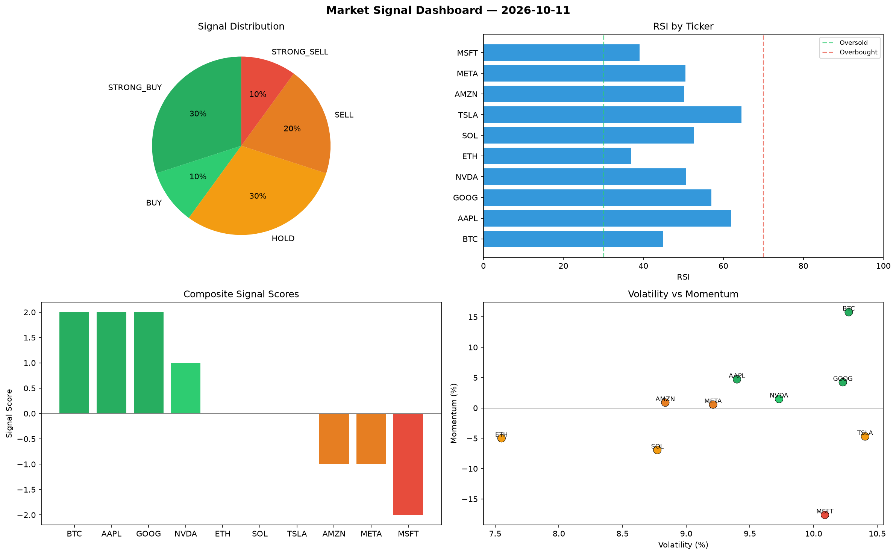

# Market Signal Report — 2026-10-11

**Run ID:** `073d30c3da` | **Buy:** 4 | **Sell:** 3 | **Hold:** 3

## Signal Dashboard

| Ticker | Price | Signal | Score | RSI | Momentum | Confidence |
|--------|-------|--------|-------|-----|----------|------------|
| BTC | $1764.86 | **STRONG_BUY** | 2 | 45.0 | 0.1579 | 0.5 |
| AAPL | $1714.99 | **STRONG_BUY** | 2 | 61.92 | 0.0472 | 0.5 |
| GOOG | $183.45 | **STRONG_BUY** | 2 | 56.98 | 0.0424 | 0.5 |
| NVDA | $337.39 | **BUY** | 1 | 50.66 | 0.0148 | 0.25 |
| ETH | $4323.16 | **HOLD** | 0 | 36.96 | -0.0499 | 0.0 |
| SOL | $3497.03 | **HOLD** | 0 | 52.7 | -0.0693 | 0.0 |
| TSLA | $2888.3 | **HOLD** | 0 | 64.57 | -0.0469 | 0.0 |
| AMZN | $4270.92 | **SELL** | -1 | 50.2 | 0.0089 | 0.25 |
| META | $477.12 | **SELL** | -1 | 50.54 | 0.0055 | 0.25 |
| MSFT | $141.28 | **STRONG_SELL** | -2 | 39.08 | -0.1762 | 0.5 |

## Delta vs Yesterday

| Ticker | Today | Yesterday | Price Change | Signal Changed |
|--------|-------|-----------|-------------|----------------|
| BTC | STRONG_BUY | STRONG_SELL | 📉 -56.37% | ⚠️ YES |
| AAPL | STRONG_BUY | SELL | 📈 99.55% | ⚠️ YES |
| GOOG | STRONG_BUY | SELL | 📉 -96.05% | ⚠️ YES |
| NVDA | BUY | HOLD | 📉 -86.13% | ⚠️ YES |
| ETH | HOLD | HOLD | 📈 77.5% | — |
| SOL | HOLD | HOLD | 📈 19.1% | — |
| TSLA | HOLD | STRONG_BUY | 📈 10.38% | ⚠️ YES |
| AMZN | SELL | SELL | 📈 38.78% | — |
| META | SELL | STRONG_SELL | 📉 -81.47% | ⚠️ YES |
| MSFT | STRONG_SELL | BUY | 📉 -96.82% | ⚠️ YES |