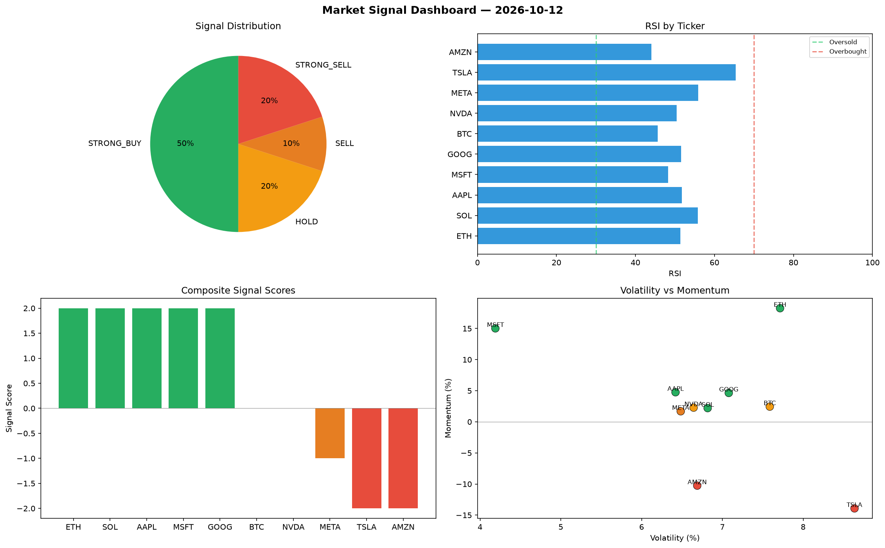

# Market Signal Report — 2026-10-12

**Run ID:** `3f71cfa7f8` | **Buy:** 5 | **Sell:** 3 | **Hold:** 2

## Signal Dashboard

| Ticker | Price | Signal | Score | RSI | Momentum | Confidence |
|--------|-------|--------|-------|-----|----------|------------|
| ETH | $1604.06 | **STRONG_BUY** | 2 | 51.37 | 0.1826 | 0.5 |
| SOL | $3126.44 | **STRONG_BUY** | 2 | 55.81 | 0.022 | 0.5 |
| AAPL | $3765.13 | **STRONG_BUY** | 2 | 51.75 | 0.0475 | 0.5 |
| MSFT | $3255.51 | **STRONG_BUY** | 2 | 48.29 | 0.1502 | 0.5 |
| GOOG | $2394.95 | **STRONG_BUY** | 2 | 51.6 | 0.0464 | 0.5 |
| BTC | $2005.3 | **HOLD** | 0 | 45.68 | 0.0244 | 0.0 |
| NVDA | $1710.75 | **HOLD** | 0 | 50.47 | 0.0228 | 0.0 |
| META | $1519.98 | **SELL** | -1 | 55.9 | 0.0169 | 0.25 |
| TSLA | $1013.41 | **STRONG_SELL** | -2 | 65.38 | -0.1392 | 0.5 |
| AMZN | $411.36 | **STRONG_SELL** | -2 | 44.05 | -0.1026 | 0.5 |

## Delta vs Yesterday

| Ticker | Today | Yesterday | Price Change | Signal Changed |
|--------|-------|-----------|-------------|----------------|
| ETH | STRONG_BUY | HOLD | 📉 -38.97% | ⚠️ YES |
| SOL | STRONG_BUY | HOLD | 📈 225.24% | ⚠️ YES |
| AAPL | STRONG_BUY | HOLD | 📈 30.99% | ⚠️ YES |
| MSFT | STRONG_BUY | STRONG_BUY | 📈 162.25% | — |
| GOOG | STRONG_BUY | SELL | 📈 33.56% | ⚠️ YES |
| BTC | HOLD | STRONG_SELL | 📉 -29.87% | ⚠️ YES |
| NVDA | HOLD | HOLD | 📉 -56.37% | — |
| META | SELL | STRONG_BUY | 📈 21.03% | ⚠️ YES |
| TSLA | STRONG_SELL | STRONG_BUY | 📉 -70.69% | ⚠️ YES |
| AMZN | STRONG_SELL | STRONG_SELL | 📉 -89.66% | — |