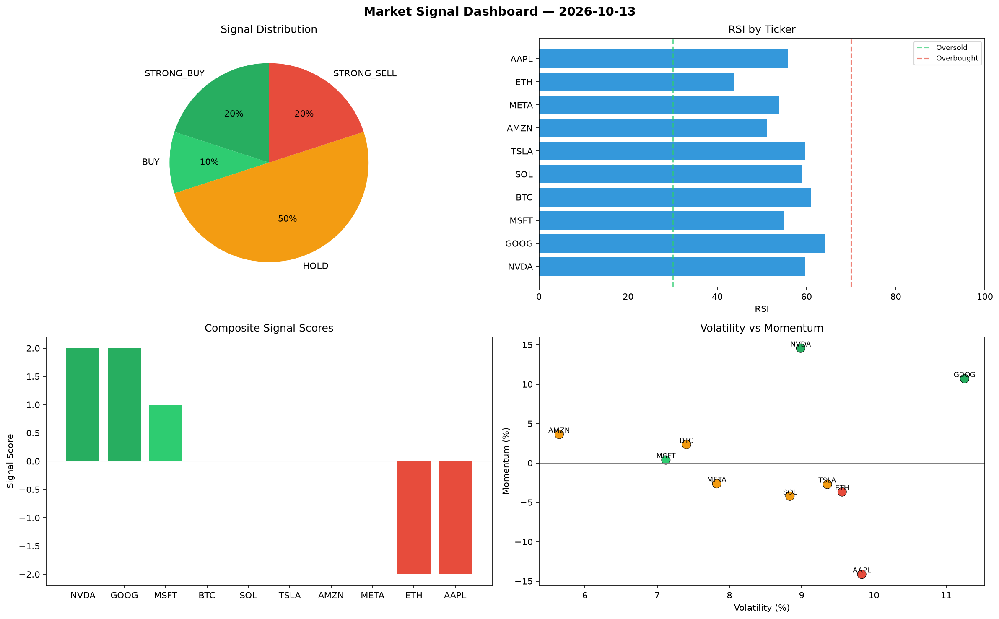

# Market Signal Report — 2026-10-13

**Run ID:** `431405f48f` | **Buy:** 3 | **Sell:** 2 | **Hold:** 5

## Signal Dashboard

| Ticker | Price | Signal | Score | RSI | Momentum | Confidence |
|--------|-------|--------|-------|-----|----------|------------|
| NVDA | $2342.28 | **STRONG_BUY** | 2 | 59.74 | 0.1458 | 0.5 |
| GOOG | $401.27 | **STRONG_BUY** | 2 | 64.05 | 0.1071 | 0.5 |
| MSFT | $4280.47 | **BUY** | 1 | 55.03 | 0.0038 | 0.25 |
| BTC | $358.39 | **HOLD** | 0 | 61.09 | 0.0234 | 0.0 |
| SOL | $1232.14 | **HOLD** | 0 | 58.96 | -0.0421 | 0.0 |
| TSLA | $4670.63 | **HOLD** | 0 | 59.7 | -0.027 | 0.0 |
| AMZN | $3670.89 | **HOLD** | 0 | 51.07 | 0.0363 | 0.0 |
| META | $4288.48 | **HOLD** | 0 | 53.82 | -0.0263 | 0.0 |
| ETH | $170.23 | **STRONG_SELL** | -2 | 43.76 | -0.0367 | 0.5 |
| AAPL | $3483.18 | **STRONG_SELL** | -2 | 55.91 | -0.1413 | 0.5 |

## Delta vs Yesterday

| Ticker | Today | Yesterday | Price Change | Signal Changed |
|--------|-------|-----------|-------------|----------------|
| NVDA | STRONG_BUY | STRONG_SELL | 📉 -48.65% | ⚠️ YES |
| GOOG | STRONG_BUY | STRONG_SELL | 📉 -64.18% | ⚠️ YES |
| MSFT | BUY | STRONG_SELL | 📈 10.52% | ⚠️ YES |
| BTC | HOLD | STRONG_BUY | 📉 -56.63% | ⚠️ YES |
| SOL | HOLD | HOLD | 📉 -74.54% | — |
| TSLA | HOLD | HOLD | 📈 177.35% | — |
| AMZN | HOLD | BUY | 📉 -17.57% | ⚠️ YES |
| META | HOLD | HOLD | 📈 512.73% | — |
| ETH | STRONG_SELL | SELL | 📉 -94.14% | ⚠️ YES |
| AAPL | STRONG_SELL | STRONG_SELL | 📉 -14.75% | — |