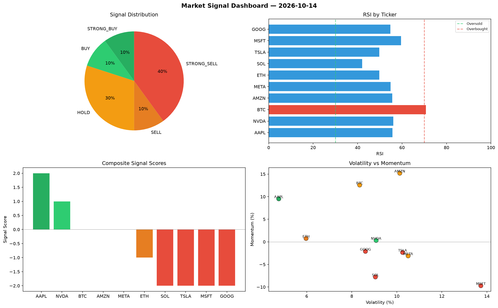

# Market Signal Report — 2026-10-14

**Run ID:** `a4fd0c1c78` | **Buy:** 2 | **Sell:** 5 | **Hold:** 3

## Signal Dashboard

| Ticker | Price | Signal | Score | RSI | Momentum | Confidence |
|--------|-------|--------|-------|-----|----------|------------|
| AAPL | $3952.89 | **STRONG_BUY** | 2 | 55.69 | 0.0952 | 0.5 |
| NVDA | $1387.81 | **BUY** | 1 | 56.03 | 0.003 | 0.25 |
| BTC | $1648.34 | **HOLD** | 0 | 70.74 | 0.1257 | 0.0 |
| AMZN | $3911.46 | **HOLD** | 0 | 55.58 | 0.1519 | 0.0 |
| META | $1755.52 | **HOLD** | 0 | 54.86 | -0.0311 | 0.0 |
| ETH | $3381.3 | **SELL** | -1 | 49.73 | 0.0074 | 0.25 |
| SOL | $4587.95 | **STRONG_SELL** | -2 | 42.03 | -0.0778 | 0.5 |
| TSLA | $2466.27 | **STRONG_SELL** | -2 | 49.8 | -0.0235 | 0.5 |
| MSFT | $3092.82 | **STRONG_SELL** | -2 | 59.51 | -0.0972 | 0.5 |
| GOOG | $4322.56 | **STRONG_SELL** | -2 | 54.79 | -0.0211 | 0.5 |

## Delta vs Yesterday

| Ticker | Today | Yesterday | Price Change | Signal Changed |
|--------|-------|-----------|-------------|----------------|
| AAPL | STRONG_BUY | STRONG_SELL | 📈 643.44% | ⚠️ YES |
| NVDA | BUY | STRONG_BUY | 📉 -61.83% | ⚠️ YES |
| BTC | HOLD | STRONG_BUY | 📉 -38.97% | ⚠️ YES |
| AMZN | HOLD | STRONG_BUY | 📉 -20.1% | ⚠️ YES |
| META | HOLD | BUY | 📉 -41.08% | ⚠️ YES |
| ETH | SELL | STRONG_BUY | 📉 -9.25% | ⚠️ YES |
| SOL | STRONG_SELL | STRONG_BUY | 📈 50.93% | ⚠️ YES |
| TSLA | STRONG_SELL | HOLD | 📉 -51.15% | ⚠️ YES |
| MSFT | STRONG_SELL | HOLD | 📉 -31.33% | ⚠️ YES |
| GOOG | STRONG_SELL | STRONG_BUY | 📈 0.06% | ⚠️ YES |