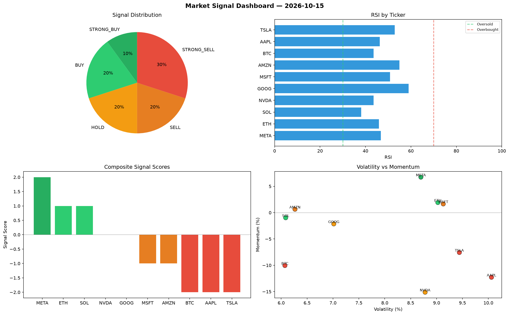

# Market Signal Report — 2026-10-15

**Run ID:** `091eff88ae` | **Buy:** 3 | **Sell:** 5 | **Hold:** 2

## Signal Dashboard

| Ticker | Price | Signal | Score | RSI | Momentum | Confidence |
|--------|-------|--------|-------|-----|----------|------------|
| META | $2901.48 | **STRONG_BUY** | 2 | 46.81 | 0.0674 | 0.5 |
| ETH | $4163.34 | **BUY** | 1 | 45.96 | 0.0192 | 0.25 |
| SOL | $4176.24 | **BUY** | 1 | 38.16 | -0.0097 | 0.25 |
| NVDA | $3354.27 | **HOLD** | 0 | 43.58 | -0.1512 | 0.0 |
| GOOG | $1131.3 | **HOLD** | 0 | 59.02 | -0.0214 | 0.0 |
| MSFT | $2137.21 | **SELL** | -1 | 50.83 | 0.0165 | 0.25 |
| AMZN | $4296.71 | **SELL** | -1 | 54.92 | 0.0064 | 0.25 |
| BTC | $622.45 | **STRONG_SELL** | -2 | 43.55 | -0.1005 | 0.5 |
| AAPL | $2146.09 | **STRONG_SELL** | -2 | 46.34 | -0.1228 | 0.5 |
| TSLA | $3086.26 | **STRONG_SELL** | -2 | 52.89 | -0.0757 | 0.5 |

## Delta vs Yesterday

| Ticker | Today | Yesterday | Price Change | Signal Changed |
|--------|-------|-----------|-------------|----------------|
| META | STRONG_BUY | HOLD | 📈 65.28% | ⚠️ YES |
| ETH | BUY | SELL | 📈 23.13% | ⚠️ YES |
| SOL | BUY | STRONG_SELL | 📉 -8.97% | ⚠️ YES |
| NVDA | HOLD | BUY | 📈 141.7% | ⚠️ YES |
| GOOG | HOLD | STRONG_SELL | 📉 -73.83% | ⚠️ YES |
| MSFT | SELL | STRONG_SELL | 📉 -30.9% | ⚠️ YES |
| AMZN | SELL | HOLD | 📈 9.85% | ⚠️ YES |
| BTC | STRONG_SELL | HOLD | 📉 -62.24% | ⚠️ YES |
| AAPL | STRONG_SELL | STRONG_BUY | 📉 -45.71% | ⚠️ YES |
| TSLA | STRONG_SELL | STRONG_SELL | 📈 25.14% | — |