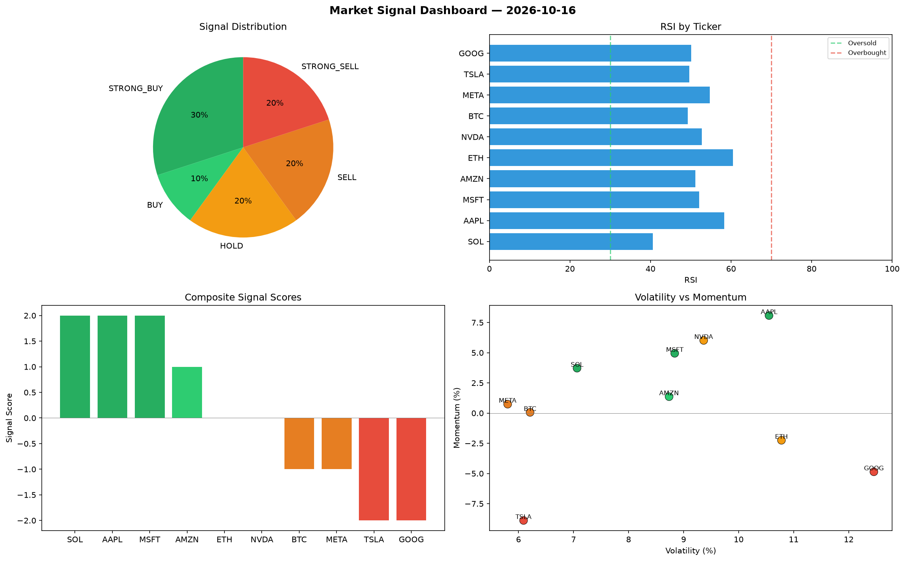

# Market Signal Report — 2026-10-16

**Run ID:** `b9645f4eec` | **Buy:** 4 | **Sell:** 4 | **Hold:** 2

## Signal Dashboard

| Ticker | Price | Signal | Score | RSI | Momentum | Confidence |
|--------|-------|--------|-------|-----|----------|------------|
| SOL | $2485.02 | **STRONG_BUY** | 2 | 40.6 | 0.0372 | 0.5 |
| AAPL | $3373.64 | **STRONG_BUY** | 2 | 58.35 | 0.0808 | 0.5 |
| MSFT | $4673.43 | **STRONG_BUY** | 2 | 52.09 | 0.0495 | 0.5 |
| AMZN | $688.15 | **BUY** | 1 | 51.13 | 0.0136 | 0.25 |
| ETH | $3746.75 | **HOLD** | 0 | 60.47 | -0.0225 | 0.0 |
| NVDA | $556.86 | **HOLD** | 0 | 52.77 | 0.0602 | 0.0 |
| BTC | $2819.91 | **SELL** | -1 | 49.29 | 0.0006 | 0.25 |
| META | $843.25 | **SELL** | -1 | 54.73 | 0.0074 | 0.25 |
| TSLA | $3608.6 | **STRONG_SELL** | -2 | 49.63 | -0.0889 | 0.5 |
| GOOG | $2615.48 | **STRONG_SELL** | -2 | 50.1 | -0.0486 | 0.5 |

## Delta vs Yesterday

| Ticker | Today | Yesterday | Price Change | Signal Changed |
|--------|-------|-----------|-------------|----------------|
| SOL | STRONG_BUY | HOLD | 📉 -12.85% | ⚠️ YES |
| AAPL | STRONG_BUY | STRONG_BUY | 📉 -23.78% | — |
| MSFT | STRONG_BUY | HOLD | 📈 85.98% | ⚠️ YES |
| AMZN | BUY | STRONG_SELL | 📉 -67.97% | ⚠️ YES |
| ETH | HOLD | STRONG_BUY | 📈 2.54% | ⚠️ YES |
| NVDA | HOLD | SELL | 📉 -83.7% | ⚠️ YES |
| BTC | SELL | HOLD | 📉 -44.32% | ⚠️ YES |
| META | SELL | STRONG_BUY | 📈 1758.2% | ⚠️ YES |
| TSLA | STRONG_SELL | STRONG_SELL | 📈 29.33% | — |
| GOOG | STRONG_SELL | STRONG_SELL | 📈 429.95% | — |