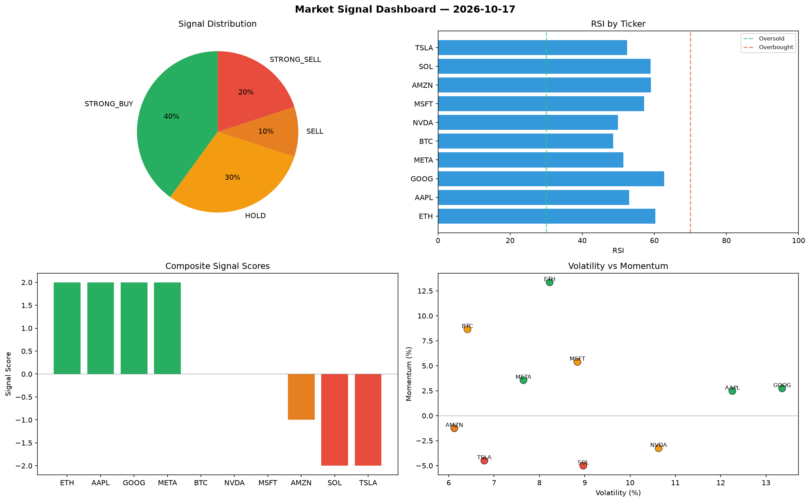

# Market Signal Report — 2026-10-17

**Run ID:** `8076edf9fc` | **Buy:** 4 | **Sell:** 3 | **Hold:** 3

## Signal Dashboard

| Ticker | Price | Signal | Score | RSI | Momentum | Confidence |
|--------|-------|--------|-------|-----|----------|------------|
| ETH | $2953.85 | **STRONG_BUY** | 2 | 60.28 | 0.1335 | 0.5 |
| AAPL | $1650.46 | **STRONG_BUY** | 2 | 53.06 | 0.0247 | 0.5 |
| GOOG | $4064.7 | **STRONG_BUY** | 2 | 62.71 | 0.0273 | 0.5 |
| META | $1743.97 | **STRONG_BUY** | 2 | 51.47 | 0.0355 | 0.5 |
| BTC | $2985.94 | **HOLD** | 0 | 48.56 | 0.0865 | 0.0 |
| NVDA | $3407.83 | **HOLD** | 0 | 49.94 | -0.0326 | 0.0 |
| MSFT | $3540.94 | **HOLD** | 0 | 57.21 | 0.0538 | 0.0 |
| AMZN | $4377.41 | **SELL** | -1 | 59.08 | -0.0126 | 0.25 |
| SOL | $326.28 | **STRONG_SELL** | -2 | 58.95 | -0.0501 | 0.5 |
| TSLA | $2149.2 | **STRONG_SELL** | -2 | 52.44 | -0.045 | 0.5 |

## Delta vs Yesterday

| Ticker | Today | Yesterday | Price Change | Signal Changed |
|--------|-------|-----------|-------------|----------------|
| ETH | STRONG_BUY | STRONG_BUY | 📈 96.37% | — |
| AAPL | STRONG_BUY | STRONG_BUY | 📈 10.75% | — |
| GOOG | STRONG_BUY | HOLD | 📈 14.94% | ⚠️ YES |
| META | STRONG_BUY | STRONG_SELL | 📈 0.56% | ⚠️ YES |
| BTC | HOLD | STRONG_BUY | 📉 -32.15% | ⚠️ YES |
| NVDA | HOLD | STRONG_BUY | 📉 -3.76% | ⚠️ YES |
| MSFT | HOLD | STRONG_SELL | 📈 356.75% | ⚠️ YES |
| AMZN | SELL | STRONG_BUY | 📉 -12.47% | ⚠️ YES |
| SOL | STRONG_SELL | SELL | 📉 -82.9% | ⚠️ YES |
| TSLA | STRONG_SELL | STRONG_BUY | 📈 832.0% | ⚠️ YES |