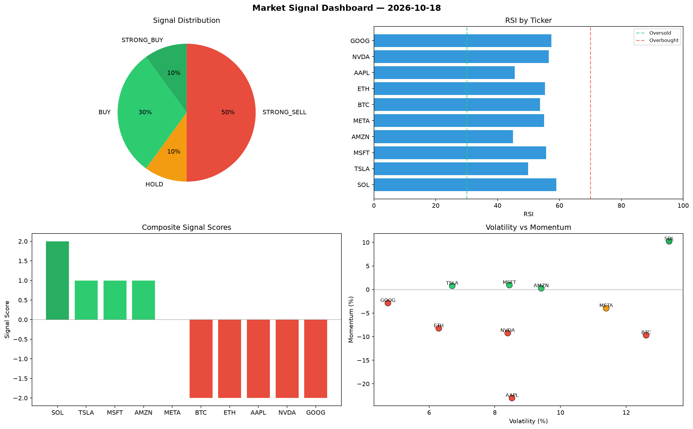

# Market Signal Report — 2026-10-18

**Run ID:** `7756ad7e94` | **Buy:** 4 | **Sell:** 5 | **Hold:** 1

## Signal Dashboard

| Ticker | Price | Signal | Score | RSI | Momentum | Confidence |
|--------|-------|--------|-------|-----|----------|------------|
| SOL | $2808.23 | **STRONG_BUY** | 2 | 59.02 | 0.1023 | 0.5 |
| TSLA | $1461.75 | **BUY** | 1 | 49.85 | 0.0078 | 0.25 |
| MSFT | $3056.37 | **BUY** | 1 | 55.66 | 0.0094 | 0.25 |
| AMZN | $2101.94 | **BUY** | 1 | 44.98 | 0.0026 | 0.25 |
| META | $3427.75 | **HOLD** | 0 | 55.01 | -0.0397 | 0.0 |
| BTC | $2539.2 | **STRONG_SELL** | -2 | 53.76 | -0.097 | 0.5 |
| ETH | $4533.99 | **STRONG_SELL** | -2 | 55.35 | -0.0823 | 0.5 |
| AAPL | $2853.27 | **STRONG_SELL** | -2 | 45.51 | -0.2301 | 0.5 |
| NVDA | $4555.36 | **STRONG_SELL** | -2 | 56.55 | -0.0924 | 0.5 |
| GOOG | $1716.59 | **STRONG_SELL** | -2 | 57.37 | -0.0287 | 0.5 |

## Delta vs Yesterday

| Ticker | Today | Yesterday | Price Change | Signal Changed |
|--------|-------|-----------|-------------|----------------|
| SOL | STRONG_BUY | STRONG_SELL | 📈 760.68% | ⚠️ YES |
| TSLA | BUY | STRONG_SELL | 📉 -31.99% | ⚠️ YES |
| MSFT | BUY | HOLD | 📉 -13.68% | ⚠️ YES |
| AMZN | BUY | SELL | 📉 -51.98% | ⚠️ YES |
| META | HOLD | STRONG_BUY | 📈 96.55% | ⚠️ YES |
| BTC | STRONG_SELL | HOLD | 📉 -14.96% | ⚠️ YES |
| ETH | STRONG_SELL | STRONG_BUY | 📈 53.49% | ⚠️ YES |
| AAPL | STRONG_SELL | STRONG_BUY | 📈 72.88% | ⚠️ YES |
| NVDA | STRONG_SELL | HOLD | 📈 33.67% | ⚠️ YES |
| GOOG | STRONG_SELL | STRONG_BUY | 📉 -57.77% | ⚠️ YES |