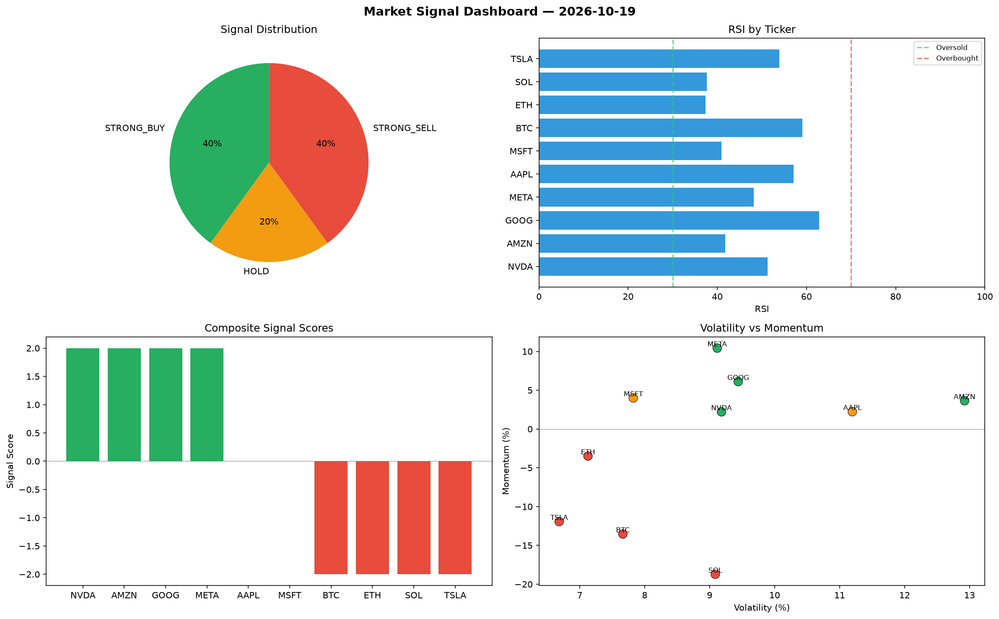

# Market Signal Report — 2026-10-19

**Run ID:** `ed68ac6998` | **Buy:** 4 | **Sell:** 4 | **Hold:** 2

## Signal Dashboard

| Ticker | Price | Signal | Score | RSI | Momentum | Confidence |
|--------|-------|--------|-------|-----|----------|------------|
| NVDA | $1118.94 | **STRONG_BUY** | 2 | 51.26 | 0.0221 | 0.5 |
| AMZN | $2326.02 | **STRONG_BUY** | 2 | 41.77 | 0.0364 | 0.5 |
| GOOG | $4211.79 | **STRONG_BUY** | 2 | 62.85 | 0.0611 | 0.5 |
| META | $129.65 | **STRONG_BUY** | 2 | 48.2 | 0.1042 | 0.5 |
| AAPL | $535.13 | **HOLD** | 0 | 57.09 | 0.0223 | 0.0 |
| MSFT | $1433.1 | **HOLD** | 0 | 40.95 | 0.04 | 0.0 |
| BTC | $820.33 | **STRONG_SELL** | -2 | 59.07 | -0.1353 | 0.5 |
| ETH | $4705.67 | **STRONG_SELL** | -2 | 37.4 | -0.0349 | 0.5 |
| SOL | $111.67 | **STRONG_SELL** | -2 | 37.64 | -0.1872 | 0.5 |
| TSLA | $2692.97 | **STRONG_SELL** | -2 | 53.89 | -0.1193 | 0.5 |

## Delta vs Yesterday

| Ticker | Today | Yesterday | Price Change | Signal Changed |
|--------|-------|-----------|-------------|----------------|
| NVDA | STRONG_BUY | SELL | 📉 -59.14% | ⚠️ YES |
| AMZN | STRONG_BUY | STRONG_SELL | 📈 1093.93% | ⚠️ YES |
| GOOG | STRONG_BUY | HOLD | 📈 210.42% | ⚠️ YES |
| META | STRONG_BUY | STRONG_SELL | 📉 -93.72% | ⚠️ YES |
| AAPL | HOLD | BUY | 📉 -72.33% | ⚠️ YES |
| MSFT | HOLD | SELL | 📈 77.65% | ⚠️ YES |
| BTC | STRONG_SELL | STRONG_SELL | 📉 -66.72% | — |
| ETH | STRONG_SELL | HOLD | 📈 1390.79% | ⚠️ YES |
| SOL | STRONG_SELL | BUY | 📉 -94.82% | ⚠️ YES |
| TSLA | STRONG_SELL | BUY | 📈 144.45% | ⚠️ YES |