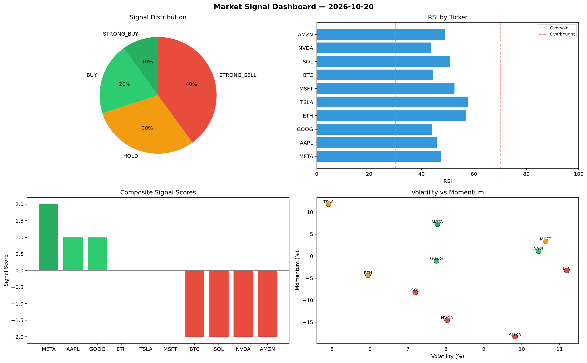

# Market Signal Report — 2026-10-20

**Run ID:** `9aca4315a4` | **Buy:** 3 | **Sell:** 4 | **Hold:** 3

## Signal Dashboard

| Ticker | Price | Signal | Score | RSI | Momentum | Confidence |
|--------|-------|--------|-------|-----|----------|------------|
| META | $2606.76 | **STRONG_BUY** | 2 | 47.43 | 0.0725 | 0.5 |
| AAPL | $2103.39 | **BUY** | 1 | 45.87 | 0.0115 | 0.25 |
| GOOG | $4316.23 | **BUY** | 1 | 44.03 | -0.0107 | 0.25 |
| ETH | $2121.93 | **HOLD** | 0 | 57.11 | -0.0433 | 0.0 |
| TSLA | $3704.12 | **HOLD** | 0 | 57.63 | 0.1181 | 0.0 |
| MSFT | $2104.86 | **HOLD** | 0 | 52.58 | 0.0335 | 0.0 |
| BTC | $1287.24 | **STRONG_SELL** | -2 | 44.49 | -0.0328 | 0.5 |
| SOL | $2419.34 | **STRONG_SELL** | -2 | 50.99 | -0.0824 | 0.5 |
| NVDA | $2113.37 | **STRONG_SELL** | -2 | 43.69 | -0.1455 | 0.5 |
| AMZN | $1773.03 | **STRONG_SELL** | -2 | 48.91 | -0.1831 | 0.5 |

## Delta vs Yesterday

| Ticker | Today | Yesterday | Price Change | Signal Changed |
|--------|-------|-----------|-------------|----------------|
| META | STRONG_BUY | STRONG_SELL | 📈 58.52% | ⚠️ YES |
| AAPL | BUY | STRONG_BUY | 📉 -32.94% | ⚠️ YES |
| GOOG | BUY | BUY | 📉 -12.63% | — |
| ETH | HOLD | HOLD | 📈 659.81% | — |
| TSLA | HOLD | HOLD | 📈 153.95% | — |
| MSFT | HOLD | STRONG_BUY | 📉 -50.34% | ⚠️ YES |
| BTC | STRONG_SELL | STRONG_BUY | 📈 288.25% | ⚠️ YES |
| SOL | STRONG_SELL | SELL | 📈 618.2% | ⚠️ YES |
| NVDA | STRONG_SELL | STRONG_SELL | 📉 -51.61% | — |
| AMZN | STRONG_SELL | STRONG_SELL | 📈 1727.3% | — |