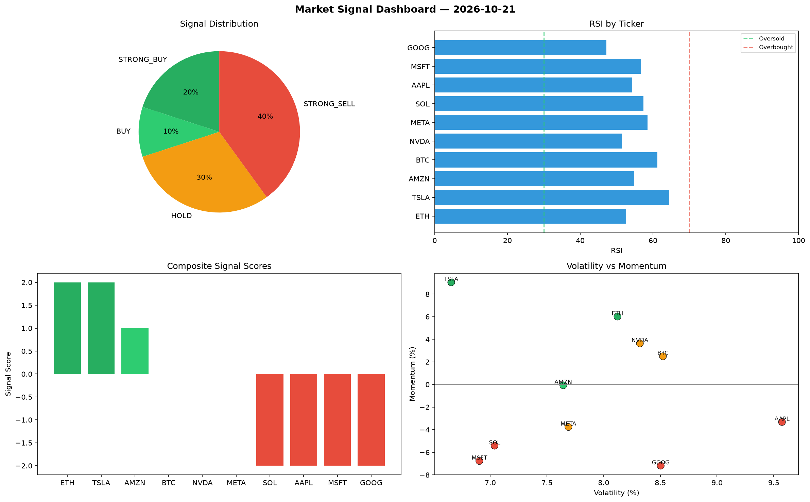

# Market Signal Report — 2026-10-21

**Run ID:** `0f861799d9` | **Buy:** 3 | **Sell:** 4 | **Hold:** 3

## Signal Dashboard

| Ticker | Price | Signal | Score | RSI | Momentum | Confidence |
|--------|-------|--------|-------|-----|----------|------------|
| ETH | $1030.73 | **STRONG_BUY** | 2 | 52.63 | 0.0601 | 0.5 |
| TSLA | $2008.58 | **STRONG_BUY** | 2 | 64.52 | 0.0904 | 0.5 |
| AMZN | $4353.87 | **BUY** | 1 | 54.81 | -0.0007 | 0.25 |
| BTC | $4696.82 | **HOLD** | 0 | 61.17 | 0.025 | 0.0 |
| NVDA | $1585.66 | **HOLD** | 0 | 51.48 | 0.0364 | 0.0 |
| META | $4178.44 | **HOLD** | 0 | 58.54 | -0.0376 | 0.0 |
| SOL | $3260.23 | **STRONG_SELL** | -2 | 57.42 | -0.0542 | 0.5 |
| AAPL | $3528.24 | **STRONG_SELL** | -2 | 54.34 | -0.0332 | 0.5 |
| MSFT | $456.66 | **STRONG_SELL** | -2 | 56.69 | -0.0677 | 0.5 |
| GOOG | $2870.98 | **STRONG_SELL** | -2 | 47.2 | -0.0719 | 0.5 |

## Delta vs Yesterday

| Ticker | Today | Yesterday | Price Change | Signal Changed |
|--------|-------|-----------|-------------|----------------|
| ETH | STRONG_BUY | HOLD | 📉 -51.42% | ⚠️ YES |
| TSLA | STRONG_BUY | HOLD | 📉 -45.77% | ⚠️ YES |
| AMZN | BUY | STRONG_SELL | 📈 145.56% | ⚠️ YES |
| BTC | HOLD | STRONG_SELL | 📈 264.88% | ⚠️ YES |
| NVDA | HOLD | STRONG_SELL | 📉 -24.97% | ⚠️ YES |
| META | HOLD | STRONG_BUY | 📈 60.29% | ⚠️ YES |
| SOL | STRONG_SELL | STRONG_SELL | 📈 34.76% | — |
| AAPL | STRONG_SELL | BUY | 📈 67.74% | ⚠️ YES |
| MSFT | STRONG_SELL | HOLD | 📉 -78.3% | ⚠️ YES |
| GOOG | STRONG_SELL | BUY | 📉 -33.48% | ⚠️ YES |