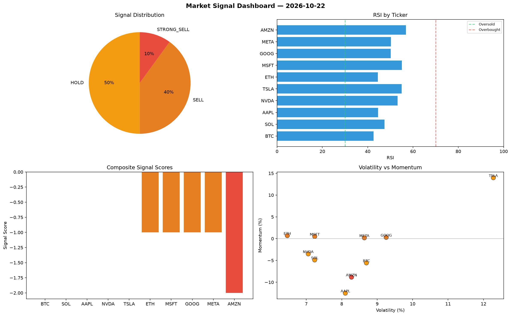

# Market Signal Report — 2026-10-22

**Run ID:** `25af47807e` | **Buy:** 0 | **Sell:** 5 | **Hold:** 5

## Signal Dashboard

| Ticker | Price | Signal | Score | RSI | Momentum | Confidence |
|--------|-------|--------|-------|-----|----------|------------|
| BTC | $2913.63 | **HOLD** | 0 | 42.63 | -0.0557 | 0.0 |
| SOL | $3148.52 | **HOLD** | 0 | 47.41 | -0.0489 | 0.0 |
| AAPL | $938.6 | **HOLD** | 0 | 44.55 | -0.1251 | 0.0 |
| NVDA | $1398.04 | **HOLD** | 0 | 53.15 | -0.035 | 0.0 |
| TSLA | $398.83 | **HOLD** | 0 | 54.99 | 0.1398 | 0.0 |
| ETH | $2883.46 | **SELL** | -1 | 44.51 | 0.0069 | 0.25 |
| MSFT | $4372.59 | **SELL** | -1 | 55.13 | 0.0051 | 0.25 |
| GOOG | $3533.72 | **SELL** | -1 | 50.13 | 0.0029 | 0.25 |
| META | $1081.01 | **SELL** | -1 | 50.22 | 0.0019 | 0.25 |
| AMZN | $444.63 | **STRONG_SELL** | -2 | 56.9 | -0.0884 | 0.5 |

## Delta vs Yesterday

| Ticker | Today | Yesterday | Price Change | Signal Changed |
|--------|-------|-----------|-------------|----------------|
| BTC | HOLD | HOLD | 📈 339.64% | — |
| SOL | HOLD | SELL | 📈 9.63% | ⚠️ YES |
| AAPL | HOLD | STRONG_SELL | 📉 -73.79% | ⚠️ YES |
| NVDA | HOLD | STRONG_SELL | 📈 62.67% | ⚠️ YES |
| TSLA | HOLD | SELL | 📉 -90.77% | ⚠️ YES |
| ETH | SELL | SELL | 📈 32.87% | — |
| MSFT | SELL | STRONG_SELL | 📈 113.44% | ⚠️ YES |
| GOOG | SELL | STRONG_SELL | 📈 44.52% | ⚠️ YES |
| META | SELL | HOLD | 📉 -69.88% | ⚠️ YES |
| AMZN | STRONG_SELL | HOLD | 📉 -89.24% | ⚠️ YES |