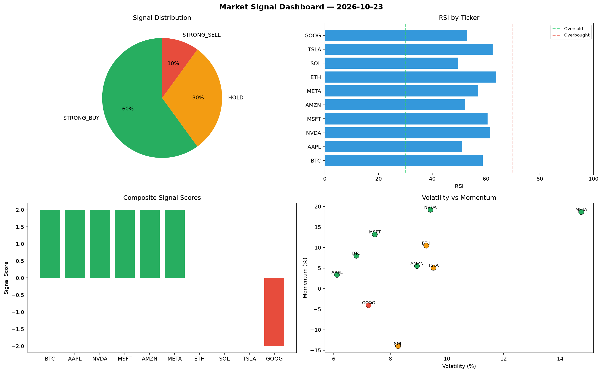

# Market Signal Report — 2026-10-23

**Run ID:** `d418fbbf63` | **Buy:** 6 | **Sell:** 1 | **Hold:** 3

## Signal Dashboard

| Ticker | Price | Signal | Score | RSI | Momentum | Confidence |
|--------|-------|--------|-------|-----|----------|------------|
| BTC | $4171.03 | **STRONG_BUY** | 2 | 58.82 | 0.08 | 0.5 |
| AAPL | $2762.25 | **STRONG_BUY** | 2 | 51.08 | 0.0336 | 0.5 |
| NVDA | $5626.8 | **STRONG_BUY** | 2 | 61.48 | 0.1919 | 0.5 |
| MSFT | $592.52 | **STRONG_BUY** | 2 | 60.59 | 0.132 | 0.5 |
| AMZN | $148.14 | **STRONG_BUY** | 2 | 52.2 | 0.0551 | 0.5 |
| META | $2210.97 | **STRONG_BUY** | 2 | 57.02 | 0.1866 | 0.5 |
| ETH | $3947.01 | **HOLD** | 0 | 63.65 | 0.1047 | 0.0 |
| SOL | $1585.65 | **HOLD** | 0 | 49.55 | -0.1397 | 0.0 |
| TSLA | $4111.41 | **HOLD** | 0 | 62.49 | 0.0508 | 0.0 |
| GOOG | $1179.03 | **STRONG_SELL** | -2 | 52.95 | -0.0404 | 0.5 |

## Delta vs Yesterday

| Ticker | Today | Yesterday | Price Change | Signal Changed |
|--------|-------|-----------|-------------|----------------|
| BTC | STRONG_BUY | HOLD | 📈 43.16% | ⚠️ YES |
| AAPL | STRONG_BUY | HOLD | 📈 194.29% | ⚠️ YES |
| NVDA | STRONG_BUY | HOLD | 📈 302.48% | ⚠️ YES |
| MSFT | STRONG_BUY | SELL | 📉 -86.45% | ⚠️ YES |
| AMZN | STRONG_BUY | STRONG_SELL | 📉 -66.68% | ⚠️ YES |
| META | STRONG_BUY | SELL | 📈 104.53% | ⚠️ YES |
| ETH | HOLD | SELL | 📈 36.88% | ⚠️ YES |
| SOL | HOLD | HOLD | 📉 -49.64% | — |
| TSLA | HOLD | HOLD | 📈 930.87% | — |
| GOOG | STRONG_SELL | SELL | 📉 -66.63% | ⚠️ YES |