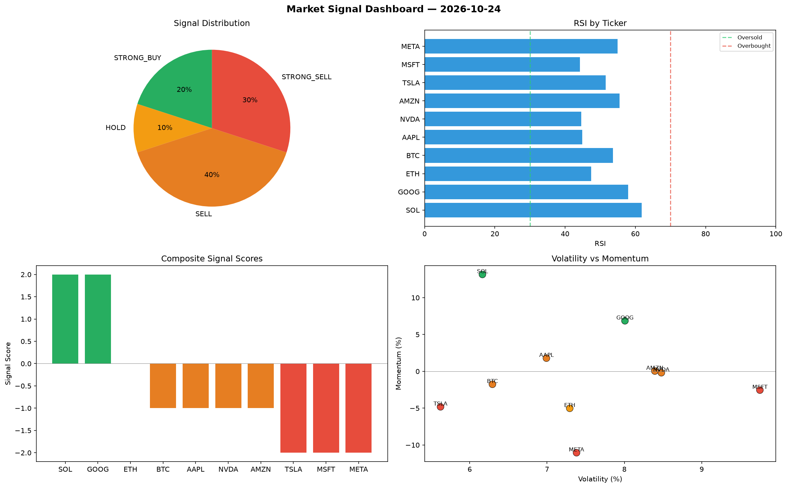

# Market Signal Report — 2026-10-24

**Run ID:** `714411107a` | **Buy:** 2 | **Sell:** 7 | **Hold:** 1

## Signal Dashboard

| Ticker | Price | Signal | Score | RSI | Momentum | Confidence |
|--------|-------|--------|-------|-----|----------|------------|
| SOL | $3564.05 | **STRONG_BUY** | 2 | 61.77 | 0.1315 | 0.5 |
| GOOG | $2958.04 | **STRONG_BUY** | 2 | 57.93 | 0.0686 | 0.5 |
| ETH | $2679.41 | **HOLD** | 0 | 47.38 | -0.0502 | 0.0 |
| BTC | $1613.91 | **SELL** | -1 | 53.65 | -0.0176 | 0.25 |
| AAPL | $1000.88 | **SELL** | -1 | 44.9 | 0.0179 | 0.25 |
| NVDA | $555.91 | **SELL** | -1 | 44.62 | -0.0019 | 0.25 |
| AMZN | $646.32 | **SELL** | -1 | 55.52 | 0.0004 | 0.25 |
| TSLA | $2937.6 | **STRONG_SELL** | -2 | 51.53 | -0.0482 | 0.5 |
| MSFT | $3257.46 | **STRONG_SELL** | -2 | 44.27 | -0.0255 | 0.5 |
| META | $1490.21 | **STRONG_SELL** | -2 | 54.96 | -0.1105 | 0.5 |

## Delta vs Yesterday

| Ticker | Today | Yesterday | Price Change | Signal Changed |
|--------|-------|-----------|-------------|----------------|
| SOL | STRONG_BUY | STRONG_BUY | 📈 3.39% | — |
| GOOG | STRONG_BUY | STRONG_BUY | 📈 85.95% | — |
| ETH | HOLD | STRONG_BUY | 📈 2.79% | ⚠️ YES |
| BTC | SELL | STRONG_SELL | 📈 0.91% | ⚠️ YES |
| AAPL | SELL | STRONG_SELL | 📈 15.45% | ⚠️ YES |
| NVDA | SELL | STRONG_BUY | 📉 -23.52% | ⚠️ YES |
| AMZN | SELL | STRONG_SELL | 📉 -71.96% | ⚠️ YES |
| TSLA | STRONG_SELL | STRONG_BUY | 📈 187.27% | ⚠️ YES |
| MSFT | STRONG_SELL | STRONG_SELL | 📈 883.62% | — |
| META | STRONG_SELL | STRONG_SELL | 📈 74.86% | — |