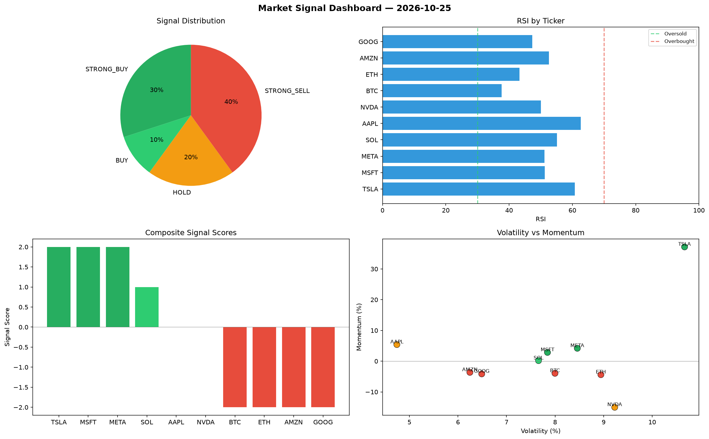

# Market Signal Report — 2026-10-25

**Run ID:** `450ff998c7` | **Buy:** 4 | **Sell:** 4 | **Hold:** 2

## Signal Dashboard

| Ticker | Price | Signal | Score | RSI | Momentum | Confidence |
|--------|-------|--------|-------|-----|----------|------------|
| TSLA | $1456.87 | **STRONG_BUY** | 2 | 60.81 | 0.3717 | 0.5 |
| MSFT | $3354.38 | **STRONG_BUY** | 2 | 51.28 | 0.0285 | 0.5 |
| META | $1577.83 | **STRONG_BUY** | 2 | 51.2 | 0.0419 | 0.5 |
| SOL | $3684.14 | **BUY** | 1 | 55.18 | 0.0018 | 0.25 |
| AAPL | $4675.57 | **HOLD** | 0 | 62.65 | 0.054 | 0.0 |
| NVDA | $4326.18 | **HOLD** | 0 | 50.06 | -0.15 | 0.0 |
| BTC | $2958.67 | **STRONG_SELL** | -2 | 37.66 | -0.0395 | 0.5 |
| ETH | $1187.21 | **STRONG_SELL** | -2 | 43.26 | -0.044 | 0.5 |
| AMZN | $1512.53 | **STRONG_SELL** | -2 | 52.58 | -0.0364 | 0.5 |
| GOOG | $3789.64 | **STRONG_SELL** | -2 | 47.29 | -0.0414 | 0.5 |

## Delta vs Yesterday

| Ticker | Today | Yesterday | Price Change | Signal Changed |
|--------|-------|-----------|-------------|----------------|
| TSLA | STRONG_BUY | STRONG_SELL | 📉 -18.15% | ⚠️ YES |
| MSFT | STRONG_BUY | HOLD | 📈 200.28% | ⚠️ YES |
| META | STRONG_BUY | HOLD | 📉 -35.35% | ⚠️ YES |
| SOL | BUY | STRONG_SELL | 📈 20.99% | ⚠️ YES |
| AAPL | HOLD | STRONG_SELL | 📈 97.69% | ⚠️ YES |
| NVDA | HOLD | SELL | 📈 456.14% | ⚠️ YES |
| BTC | STRONG_SELL | STRONG_SELL | 📈 141.71% | — |
| ETH | STRONG_SELL | HOLD | 📉 -21.58% | ⚠️ YES |
| AMZN | STRONG_SELL | HOLD | 📉 -65.25% | ⚠️ YES |
| GOOG | STRONG_SELL | HOLD | 📈 160.93% | ⚠️ YES |