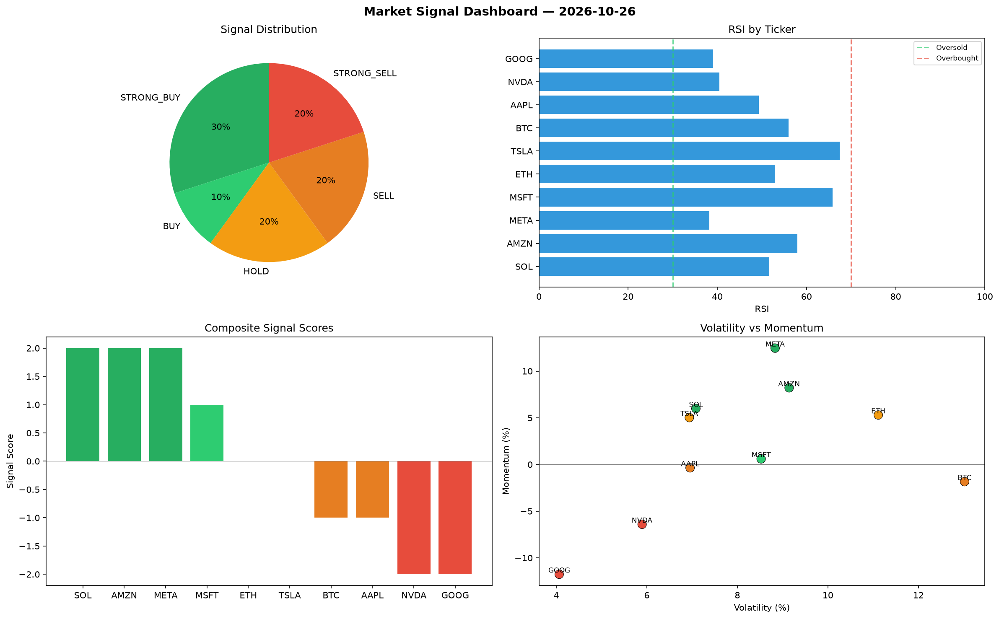

# Market Signal Report — 2026-10-26

**Run ID:** `2aff9c7012` | **Buy:** 4 | **Sell:** 4 | **Hold:** 2

## Signal Dashboard

| Ticker | Price | Signal | Score | RSI | Momentum | Confidence |
|--------|-------|--------|-------|-----|----------|------------|
| SOL | $1590.07 | **STRONG_BUY** | 2 | 51.69 | 0.0599 | 0.5 |
| AMZN | $408.69 | **STRONG_BUY** | 2 | 57.96 | 0.0821 | 0.5 |
| META | $3231.07 | **STRONG_BUY** | 2 | 38.23 | 0.1246 | 0.5 |
| MSFT | $4220.06 | **BUY** | 1 | 65.82 | 0.006 | 0.25 |
| ETH | $2378.83 | **HOLD** | 0 | 52.94 | 0.053 | 0.0 |
| TSLA | $4869.07 | **HOLD** | 0 | 67.45 | 0.0502 | 0.0 |
| BTC | $4212.5 | **SELL** | -1 | 56.0 | -0.0184 | 0.25 |
| AAPL | $4450.15 | **SELL** | -1 | 49.32 | -0.0036 | 0.25 |
| NVDA | $1169.7 | **STRONG_SELL** | -2 | 40.45 | -0.0641 | 0.5 |
| GOOG | $4550.25 | **STRONG_SELL** | -2 | 39.03 | -0.1176 | 0.5 |

## Delta vs Yesterday

| Ticker | Today | Yesterday | Price Change | Signal Changed |
|--------|-------|-----------|-------------|----------------|
| SOL | STRONG_BUY | BUY | 📉 -56.84% | ⚠️ YES |
| AMZN | STRONG_BUY | STRONG_SELL | 📉 -72.98% | ⚠️ YES |
| META | STRONG_BUY | STRONG_BUY | 📈 104.78% | — |
| MSFT | BUY | STRONG_BUY | 📈 25.81% | ⚠️ YES |
| ETH | HOLD | STRONG_SELL | 📈 100.37% | ⚠️ YES |
| TSLA | HOLD | STRONG_BUY | 📈 234.21% | ⚠️ YES |
| BTC | SELL | STRONG_SELL | 📈 42.38% | ⚠️ YES |
| AAPL | SELL | HOLD | 📉 -4.82% | ⚠️ YES |
| NVDA | STRONG_SELL | HOLD | 📉 -72.96% | ⚠️ YES |
| GOOG | STRONG_SELL | STRONG_SELL | 📈 20.07% | — |