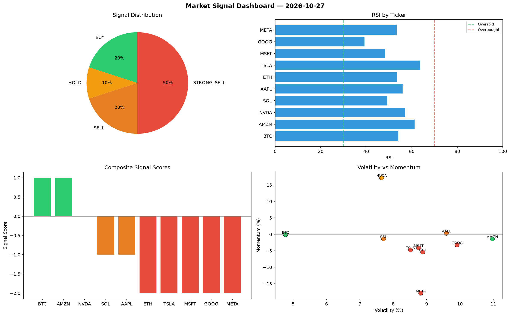

# Market Signal Report — 2026-10-27

**Run ID:** `feb7090c1e` | **Buy:** 2 | **Sell:** 7 | **Hold:** 1

## Signal Dashboard

| Ticker | Price | Signal | Score | RSI | Momentum | Confidence |
|--------|-------|--------|-------|-----|----------|------------|
| BTC | $1892.28 | **BUY** | 1 | 54.1 | -0.0008 | 0.25 |
| AMZN | $113.15 | **BUY** | 1 | 61.26 | -0.0138 | 0.25 |
| NVDA | $3642.57 | **HOLD** | 0 | 57.22 | 0.172 | 0.0 |
| SOL | $460.99 | **SELL** | -1 | 49.25 | -0.0137 | 0.25 |
| AAPL | $3613.27 | **SELL** | -1 | 55.94 | 0.0032 | 0.25 |
| ETH | $4174.87 | **STRONG_SELL** | -2 | 53.59 | -0.054 | 0.5 |
| TSLA | $4135.14 | **STRONG_SELL** | -2 | 63.79 | -0.0475 | 0.5 |
| MSFT | $2023.18 | **STRONG_SELL** | -2 | 48.4 | -0.0411 | 0.5 |
| GOOG | $3118.91 | **STRONG_SELL** | -2 | 39.29 | -0.0323 | 0.5 |
| META | $4177.73 | **STRONG_SELL** | -2 | 53.41 | -0.1788 | 0.5 |

## Delta vs Yesterday

| Ticker | Today | Yesterday | Price Change | Signal Changed |
|--------|-------|-----------|-------------|----------------|
| BTC | BUY | STRONG_SELL | 📉 -57.82% | ⚠️ YES |
| AMZN | BUY | STRONG_BUY | 📉 -97.11% | ⚠️ YES |
| NVDA | HOLD | SELL | 📈 1699.24% | ⚠️ YES |
| SOL | SELL | STRONG_SELL | 📉 -81.35% | ⚠️ YES |
| AAPL | SELL | STRONG_SELL | 📈 368.28% | ⚠️ YES |
| ETH | STRONG_SELL | HOLD | 📈 2.67% | ⚠️ YES |
| TSLA | STRONG_SELL | HOLD | 📉 -15.48% | ⚠️ YES |
| MSFT | STRONG_SELL | HOLD | 📉 -22.9% | ⚠️ YES |
| GOOG | STRONG_SELL | HOLD | 📈 34.1% | ⚠️ YES |
| META | STRONG_SELL | STRONG_BUY | 📈 193.86% | ⚠️ YES |