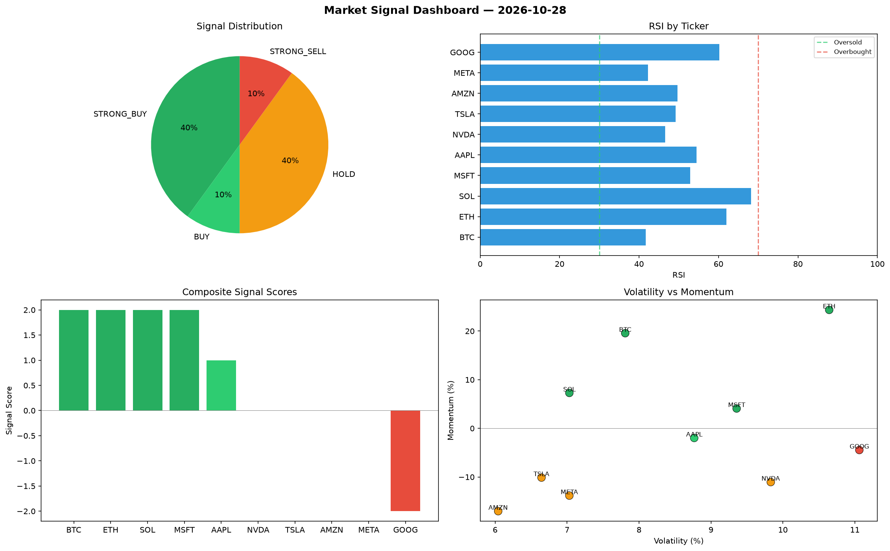

# Market Signal Report — 2026-10-28

**Run ID:** `6a34117334` | **Buy:** 5 | **Sell:** 1 | **Hold:** 4

## Signal Dashboard

| Ticker | Price | Signal | Score | RSI | Momentum | Confidence |
|--------|-------|--------|-------|-----|----------|------------|
| BTC | $3528.07 | **STRONG_BUY** | 2 | 41.72 | 0.1956 | 0.5 |
| ETH | $972.47 | **STRONG_BUY** | 2 | 62.0 | 0.2435 | 0.5 |
| SOL | $4763.02 | **STRONG_BUY** | 2 | 68.24 | 0.0728 | 0.5 |
| MSFT | $4438.79 | **STRONG_BUY** | 2 | 52.86 | 0.0408 | 0.5 |
| AAPL | $4423.16 | **BUY** | 1 | 54.51 | -0.0198 | 0.25 |
| NVDA | $183.28 | **HOLD** | 0 | 46.59 | -0.1105 | 0.0 |
| TSLA | $3154.95 | **HOLD** | 0 | 49.19 | -0.1012 | 0.0 |
| AMZN | $2938.13 | **HOLD** | 0 | 49.72 | -0.1703 | 0.0 |
| META | $2558.6 | **HOLD** | 0 | 42.21 | -0.1383 | 0.0 |
| GOOG | $2681.97 | **STRONG_SELL** | -2 | 60.18 | -0.0446 | 0.5 |

## Delta vs Yesterday

| Ticker | Today | Yesterday | Price Change | Signal Changed |
|--------|-------|-----------|-------------|----------------|
| BTC | STRONG_BUY | STRONG_SELL | 📉 -18.95% | ⚠️ YES |
| ETH | STRONG_BUY | HOLD | 📉 -12.42% | ⚠️ YES |
| SOL | STRONG_BUY | HOLD | 📈 0.03% | ⚠️ YES |
| MSFT | STRONG_BUY | SELL | 📈 129.89% | ⚠️ YES |
| AAPL | BUY | STRONG_SELL | 📈 7.87% | ⚠️ YES |
| NVDA | HOLD | STRONG_SELL | 📉 -95.48% | ⚠️ YES |
| TSLA | HOLD | STRONG_BUY | 📉 -43.32% | ⚠️ YES |
| AMZN | HOLD | STRONG_BUY | 📈 8.7% | ⚠️ YES |
| META | HOLD | STRONG_SELL | 📉 -43.18% | ⚠️ YES |
| GOOG | STRONG_SELL | STRONG_SELL | 📈 6091.07% | — |