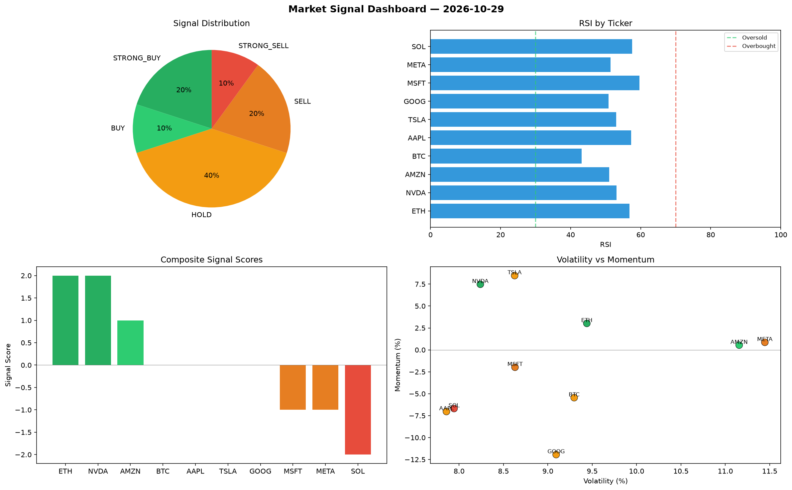

# Market Signal Report — 2026-10-29

**Run ID:** `f82a2d9617` | **Buy:** 3 | **Sell:** 3 | **Hold:** 4

## Signal Dashboard

| Ticker | Price | Signal | Score | RSI | Momentum | Confidence |
|--------|-------|--------|-------|-----|----------|------------|
| ETH | $3723.65 | **STRONG_BUY** | 2 | 56.84 | 0.0302 | 0.5 |
| NVDA | $174.4 | **STRONG_BUY** | 2 | 53.08 | 0.0748 | 0.5 |
| AMZN | $1898.63 | **BUY** | 1 | 50.98 | 0.0054 | 0.25 |
| BTC | $45.45 | **HOLD** | 0 | 43.14 | -0.0545 | 0.0 |
| AAPL | $3843.46 | **HOLD** | 0 | 57.27 | -0.0703 | 0.0 |
| TSLA | $3986.58 | **HOLD** | 0 | 53.01 | 0.0847 | 0.0 |
| GOOG | $613.92 | **HOLD** | 0 | 50.85 | -0.1194 | 0.0 |
| MSFT | $488.5 | **SELL** | -1 | 59.64 | -0.0198 | 0.25 |
| META | $2472.97 | **SELL** | -1 | 51.37 | 0.0086 | 0.25 |
| SOL | $3110.81 | **STRONG_SELL** | -2 | 57.54 | -0.0669 | 0.5 |

## Delta vs Yesterday

| Ticker | Today | Yesterday | Price Change | Signal Changed |
|--------|-------|-----------|-------------|----------------|
| ETH | STRONG_BUY | STRONG_SELL | 📈 260.42% | ⚠️ YES |
| NVDA | STRONG_BUY | STRONG_SELL | 📉 -93.99% | ⚠️ YES |
| AMZN | BUY | STRONG_BUY | 📈 502.91% | ⚠️ YES |
| BTC | HOLD | HOLD | 📉 -93.38% | — |
| AAPL | HOLD | HOLD | 📈 19.97% | — |
| TSLA | HOLD | BUY | 📈 202.63% | ⚠️ YES |
| GOOG | HOLD | SELL | 📉 -79.66% | ⚠️ YES |
| MSFT | SELL | STRONG_SELL | 📉 -89.74% | ⚠️ YES |
| META | SELL | HOLD | 📉 -19.02% | ⚠️ YES |
| SOL | STRONG_SELL | STRONG_BUY | 📈 5.92% | ⚠️ YES |