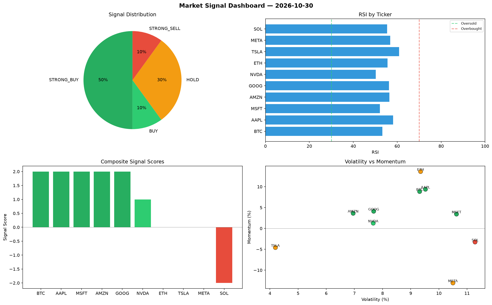

# Market Signal Report — 2026-10-30

**Run ID:** `bf9a5af6ba` | **Buy:** 6 | **Sell:** 1 | **Hold:** 3

## Signal Dashboard

| Ticker | Price | Signal | Score | RSI | Momentum | Confidence |
|--------|-------|--------|-------|-----|----------|------------|
| BTC | $1678.52 | **STRONG_BUY** | 2 | 53.21 | 0.0884 | 0.5 |
| AAPL | $2223.72 | **STRONG_BUY** | 2 | 58.18 | 0.0938 | 0.5 |
| MSFT | $4634.79 | **STRONG_BUY** | 2 | 52.08 | 0.0343 | 0.5 |
| AMZN | $1356.54 | **STRONG_BUY** | 2 | 56.41 | 0.0362 | 0.5 |
| GOOG | $1379.17 | **STRONG_BUY** | 2 | 56.3 | 0.0411 | 0.5 |
| NVDA | $4509.79 | **BUY** | 1 | 50.28 | 0.0126 | 0.25 |
| ETH | $3754.72 | **HOLD** | 0 | 55.59 | 0.1363 | 0.0 |
| TSLA | $1835.57 | **HOLD** | 0 | 60.91 | -0.0458 | 0.0 |
| META | $3222.22 | **HOLD** | 0 | 56.87 | -0.1306 | 0.0 |
| SOL | $985.48 | **STRONG_SELL** | -2 | 55.37 | -0.0326 | 0.5 |

## Delta vs Yesterday

| Ticker | Today | Yesterday | Price Change | Signal Changed |
|--------|-------|-----------|-------------|----------------|
| BTC | STRONG_BUY | STRONG_BUY | 📈 35.97% | — |
| AAPL | STRONG_BUY | SELL | 📉 -34.02% | ⚠️ YES |
| MSFT | STRONG_BUY | STRONG_BUY | 📈 53.72% | — |
| AMZN | STRONG_BUY | STRONG_BUY | 📈 36.11% | — |
| GOOG | STRONG_BUY | BUY | 📉 -64.02% | ⚠️ YES |
| NVDA | BUY | STRONG_SELL | 📈 22.31% | ⚠️ YES |
| ETH | HOLD | STRONG_SELL | 📈 59.3% | ⚠️ YES |
| TSLA | HOLD | STRONG_SELL | 📉 -12.1% | ⚠️ YES |
| META | HOLD | STRONG_SELL | 📈 267.59% | ⚠️ YES |
| SOL | STRONG_SELL | BUY | 📉 -77.22% | ⚠️ YES |