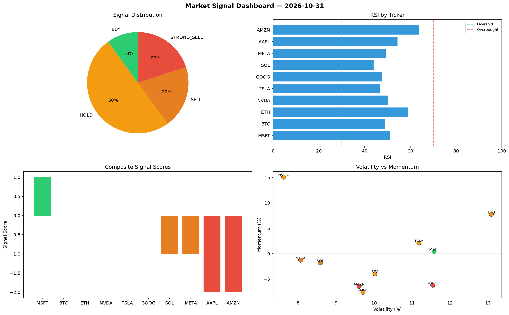

# Market Signal Report — 2026-10-31

**Run ID:** `bd5ccbc657` | **Buy:** 3 | **Sell:** 6 | **Hold:** 1

## Signal Dashboard

| Ticker | Price | Signal | Score | RSI | Momentum | Confidence |
|--------|-------|--------|-------|-----|----------|------------|
| BTC | $453.81 | **STRONG_BUY** | 2 | 53.53 | 0.0938 | 0.5 |
| SOL | $1312.58 | **STRONG_BUY** | 2 | 52.61 | 0.07 | 0.5 |
| AMZN | $1737.73 | **STRONG_BUY** | 2 | 46.13 | 0.0509 | 0.5 |
| TSLA | $682.31 | **HOLD** | 0 | 50.66 | 0.0249 | 0.0 |
| AAPL | $4286.59 | **SELL** | -1 | 61.76 | 0.0094 | 0.25 |
| ETH | $2391.05 | **STRONG_SELL** | -2 | 42.1 | -0.0753 | 0.5 |
| NVDA | $458.02 | **STRONG_SELL** | -2 | 53.94 | -0.0809 | 0.5 |
| MSFT | $223.31 | **STRONG_SELL** | -2 | 48.42 | -0.0947 | 0.5 |
| GOOG | $1417.89 | **STRONG_SELL** | -2 | 43.59 | -0.0713 | 0.5 |
| META | $1297.03 | **STRONG_SELL** | -2 | 55.16 | -0.0296 | 0.5 |

## Delta vs Yesterday

| Ticker | Today | Yesterday | Price Change | Signal Changed |
|--------|-------|-----------|-------------|----------------|
| BTC | STRONG_BUY | STRONG_BUY | 📉 -72.96% | — |
| SOL | STRONG_BUY | STRONG_SELL | 📈 33.19% | ⚠️ YES |
| AMZN | STRONG_BUY | STRONG_BUY | 📈 28.1% | — |
| TSLA | HOLD | HOLD | 📉 -62.83% | — |
| AAPL | SELL | STRONG_BUY | 📈 92.77% | ⚠️ YES |
| ETH | STRONG_SELL | HOLD | 📉 -36.32% | ⚠️ YES |
| NVDA | STRONG_SELL | BUY | 📉 -89.84% | ⚠️ YES |
| MSFT | STRONG_SELL | STRONG_BUY | 📉 -95.18% | ⚠️ YES |
| GOOG | STRONG_SELL | STRONG_BUY | 📈 2.81% | ⚠️ YES |
| META | STRONG_SELL | HOLD | 📉 -59.75% | ⚠️ YES |