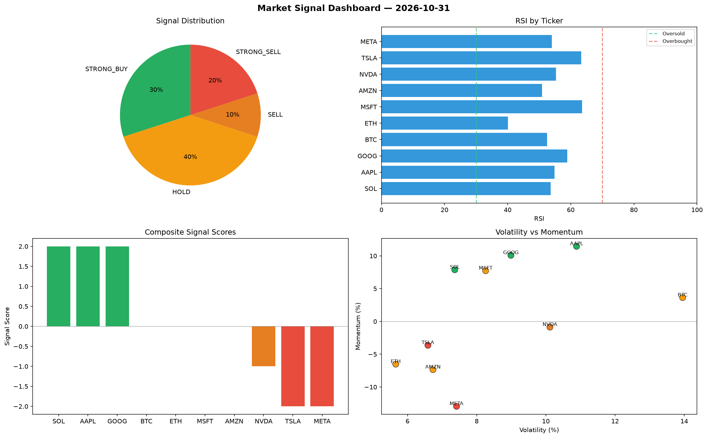

# Market Signal Report — 2026-10-31

**Run ID:** `3315459601` | **Buy:** 3 | **Sell:** 3 | **Hold:** 4

## Signal Dashboard

| Ticker | Price | Signal | Score | RSI | Momentum | Confidence |
|--------|-------|--------|-------|-----|----------|------------|
| SOL | $4754.25 | **STRONG_BUY** | 2 | 53.61 | 0.0788 | 0.5 |
| AAPL | $2011.42 | **STRONG_BUY** | 2 | 54.83 | 0.1145 | 0.5 |
| GOOG | $3522.26 | **STRONG_BUY** | 2 | 58.93 | 0.1008 | 0.5 |
| BTC | $659.19 | **HOLD** | 0 | 52.5 | 0.0363 | 0.0 |
| ETH | $599.98 | **HOLD** | 0 | 40.09 | -0.0652 | 0.0 |
| MSFT | $502.26 | **HOLD** | 0 | 63.58 | 0.0773 | 0.0 |
| AMZN | $470.58 | **HOLD** | 0 | 50.91 | -0.0736 | 0.0 |
| NVDA | $391.29 | **SELL** | -1 | 55.28 | -0.0087 | 0.25 |
| TSLA | $2610.4 | **STRONG_SELL** | -2 | 63.32 | -0.0364 | 0.5 |
| META | $993.32 | **STRONG_SELL** | -2 | 53.99 | -0.1295 | 0.5 |

## Delta vs Yesterday

| Ticker | Today | Yesterday | Price Change | Signal Changed |
|--------|-------|-----------|-------------|----------------|
| SOL | STRONG_BUY | STRONG_SELL | 📈 382.43% | ⚠️ YES |
| AAPL | STRONG_BUY | STRONG_BUY | 📉 -9.55% | — |
| GOOG | STRONG_BUY | STRONG_BUY | 📈 155.39% | — |
| BTC | HOLD | STRONG_BUY | 📉 -60.73% | ⚠️ YES |
| ETH | HOLD | HOLD | 📉 -84.02% | — |
| MSFT | HOLD | STRONG_BUY | 📉 -89.16% | ⚠️ YES |
| AMZN | HOLD | STRONG_BUY | 📉 -65.31% | ⚠️ YES |
| NVDA | SELL | BUY | 📉 -91.32% | ⚠️ YES |
| TSLA | STRONG_SELL | HOLD | 📈 42.21% | ⚠️ YES |
| META | STRONG_SELL | HOLD | 📉 -69.17% | ⚠️ YES |