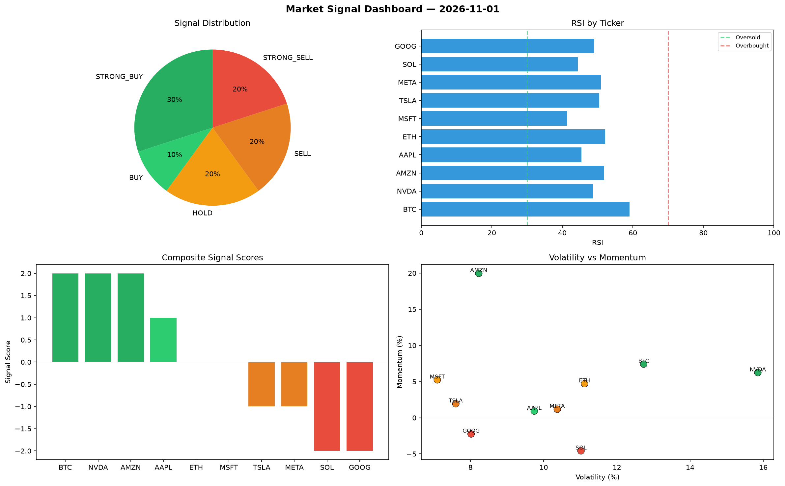

# Market Signal Report — 2026-11-01

**Run ID:** `733da623c4` | **Buy:** 4 | **Sell:** 4 | **Hold:** 2

## Signal Dashboard

| Ticker | Price | Signal | Score | RSI | Momentum | Confidence |
|--------|-------|--------|-------|-----|----------|------------|
| BTC | $645.21 | **STRONG_BUY** | 2 | 59.1 | 0.0742 | 0.5 |
| NVDA | $188.13 | **STRONG_BUY** | 2 | 48.65 | 0.0624 | 0.5 |
| AMZN | $2043.41 | **STRONG_BUY** | 2 | 51.82 | 0.1997 | 0.5 |
| AAPL | $1378.69 | **BUY** | 1 | 45.46 | 0.0093 | 0.25 |
| ETH | $2375.22 | **HOLD** | 0 | 52.11 | 0.0471 | 0.0 |
| MSFT | $130.03 | **HOLD** | 0 | 41.29 | 0.0524 | 0.0 |
| TSLA | $4041.29 | **SELL** | -1 | 50.49 | 0.0193 | 0.25 |
| META | $3677.64 | **SELL** | -1 | 50.92 | 0.0118 | 0.25 |
| SOL | $3213.79 | **STRONG_SELL** | -2 | 44.42 | -0.0458 | 0.5 |
| GOOG | $4343.19 | **STRONG_SELL** | -2 | 48.99 | -0.0224 | 0.5 |

## Delta vs Yesterday

| Ticker | Today | Yesterday | Price Change | Signal Changed |
|--------|-------|-----------|-------------|----------------|
| BTC | STRONG_BUY | STRONG_BUY | 📈 42.18% | — |
| NVDA | STRONG_BUY | STRONG_SELL | 📉 -58.93% | ⚠️ YES |
| AMZN | STRONG_BUY | STRONG_BUY | 📈 17.59% | — |
| AAPL | BUY | SELL | 📉 -67.84% | ⚠️ YES |
| ETH | HOLD | STRONG_SELL | 📉 -0.66% | ⚠️ YES |
| MSFT | HOLD | STRONG_SELL | 📉 -41.77% | ⚠️ YES |
| TSLA | SELL | HOLD | 📈 492.3% | ⚠️ YES |
| META | SELL | STRONG_SELL | 📈 183.54% | ⚠️ YES |
| SOL | STRONG_SELL | STRONG_BUY | 📈 144.85% | ⚠️ YES |
| GOOG | STRONG_SELL | STRONG_SELL | 📈 206.31% | — |