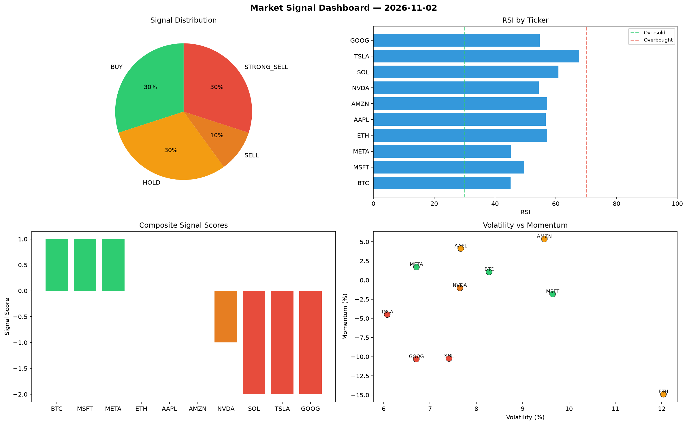

# Market Signal Report — 2026-11-02

**Run ID:** `fd85dc1351` | **Buy:** 3 | **Sell:** 4 | **Hold:** 3

## Signal Dashboard

| Ticker | Price | Signal | Score | RSI | Momentum | Confidence |
|--------|-------|--------|-------|-----|----------|------------|
| BTC | $4704.91 | **BUY** | 1 | 45.12 | 0.0106 | 0.25 |
| MSFT | $3949.34 | **BUY** | 1 | 49.62 | -0.0182 | 0.25 |
| META | $3460.07 | **BUY** | 1 | 45.25 | 0.017 | 0.25 |
| ETH | $4836.98 | **HOLD** | 0 | 57.22 | -0.1491 | 0.0 |
| AAPL | $587.93 | **HOLD** | 0 | 56.75 | 0.0412 | 0.0 |
| AMZN | $1521.59 | **HOLD** | 0 | 57.18 | 0.0536 | 0.0 |
| NVDA | $4134.97 | **SELL** | -1 | 54.46 | -0.0103 | 0.25 |
| SOL | $3833.09 | **STRONG_SELL** | -2 | 60.93 | -0.1024 | 0.5 |
| TSLA | $3324.35 | **STRONG_SELL** | -2 | 67.72 | -0.045 | 0.5 |
| GOOG | $2318.41 | **STRONG_SELL** | -2 | 54.71 | -0.1032 | 0.5 |

## Delta vs Yesterday

| Ticker | Today | Yesterday | Price Change | Signal Changed |
|--------|-------|-----------|-------------|----------------|
| BTC | BUY | HOLD | 📈 769.43% | ⚠️ YES |
| MSFT | BUY | STRONG_BUY | 📉 -19.31% | ⚠️ YES |
| META | BUY | STRONG_BUY | 📈 2199.51% | ⚠️ YES |
| ETH | HOLD | SELL | 📈 215.94% | ⚠️ YES |
| AAPL | HOLD | STRONG_SELL | 📉 -47.55% | ⚠️ YES |
| AMZN | HOLD | HOLD | 📈 438.12% | — |
| NVDA | SELL | STRONG_SELL | 📈 12.43% | ⚠️ YES |
| SOL | STRONG_SELL | STRONG_BUY | 📉 -18.21% | ⚠️ YES |
| TSLA | STRONG_SELL | HOLD | 📉 -17.74% | ⚠️ YES |
| GOOG | STRONG_SELL | SELL | 📈 49.2% | ⚠️ YES |