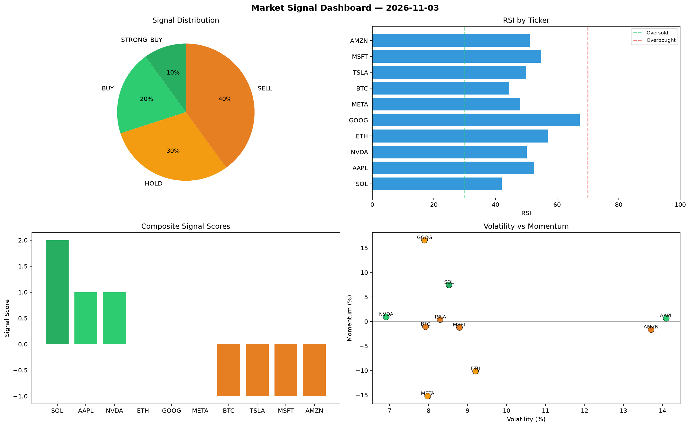

# Market Signal Report — 2026-11-03

**Run ID:** `434a04b160` | **Buy:** 3 | **Sell:** 4 | **Hold:** 3

## Signal Dashboard

| Ticker | Price | Signal | Score | RSI | Momentum | Confidence |
|--------|-------|--------|-------|-----|----------|------------|
| SOL | $2227.79 | **STRONG_BUY** | 2 | 42.04 | 0.0746 | 0.5 |
| AAPL | $4404.66 | **BUY** | 1 | 52.45 | 0.0065 | 0.25 |
| NVDA | $4131.62 | **BUY** | 1 | 50.15 | 0.0092 | 0.25 |
| ETH | $1433.07 | **HOLD** | 0 | 57.08 | -0.1016 | 0.0 |
| GOOG | $967.06 | **HOLD** | 0 | 67.38 | 0.1658 | 0.0 |
| META | $2313.45 | **HOLD** | 0 | 48.11 | -0.1524 | 0.0 |
| BTC | $3395.29 | **SELL** | -1 | 44.37 | -0.0108 | 0.25 |
| TSLA | $3279.71 | **SELL** | -1 | 49.93 | 0.0037 | 0.25 |
| MSFT | $3968.2 | **SELL** | -1 | 54.86 | -0.0123 | 0.25 |
| AMZN | $3089.98 | **SELL** | -1 | 51.2 | -0.0166 | 0.25 |

## Delta vs Yesterday

| Ticker | Today | Yesterday | Price Change | Signal Changed |
|--------|-------|-----------|-------------|----------------|
| SOL | STRONG_BUY | HOLD | 📉 -45.08% | ⚠️ YES |
| AAPL | BUY | HOLD | 📈 205.67% | ⚠️ YES |
| NVDA | BUY | STRONG_BUY | 📈 8.36% | ⚠️ YES |
| ETH | HOLD | STRONG_SELL | 📉 -59.56% | ⚠️ YES |
| GOOG | HOLD | STRONG_BUY | 📉 -37.58% | ⚠️ YES |
| META | HOLD | HOLD | 📉 -47.83% | — |
| BTC | SELL | STRONG_BUY | 📈 105.49% | ⚠️ YES |
| TSLA | SELL | BUY | 📉 -26.78% | ⚠️ YES |
| MSFT | SELL | STRONG_SELL | 📈 127.62% | ⚠️ YES |
| AMZN | SELL | BUY | 📈 55.6% | ⚠️ YES |