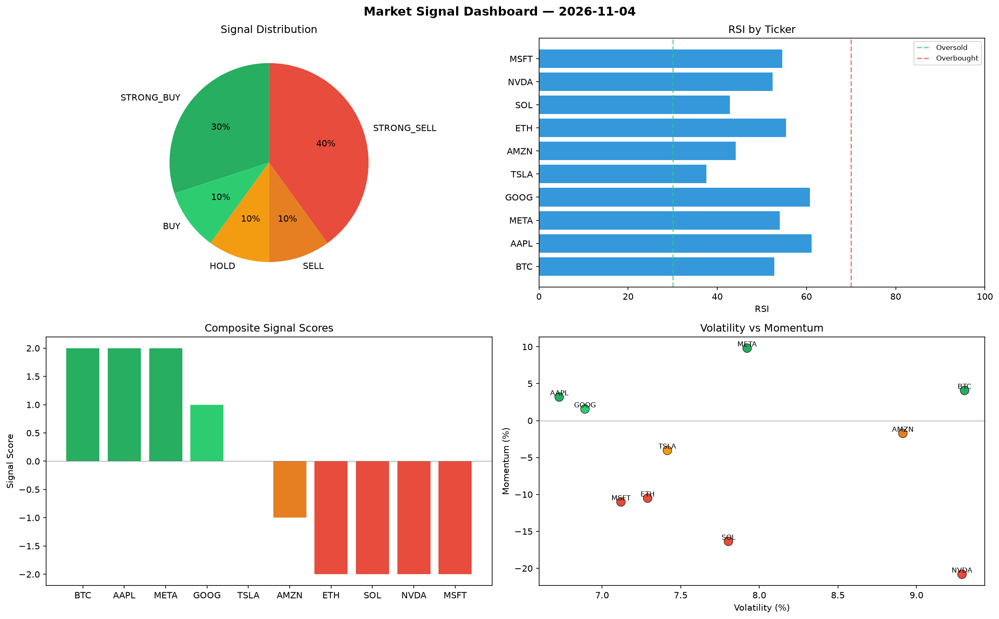

# Market Signal Report — 2026-11-04

**Run ID:** `8393f51baa` | **Buy:** 4 | **Sell:** 5 | **Hold:** 1

## Signal Dashboard

| Ticker | Price | Signal | Score | RSI | Momentum | Confidence |
|--------|-------|--------|-------|-----|----------|------------|
| BTC | $3535.21 | **STRONG_BUY** | 2 | 52.75 | 0.0408 | 0.5 |
| AAPL | $3210.16 | **STRONG_BUY** | 2 | 61.11 | 0.0319 | 0.5 |
| META | $2188.63 | **STRONG_BUY** | 2 | 54.05 | 0.0981 | 0.5 |
| GOOG | $4788.69 | **BUY** | 1 | 60.74 | 0.0157 | 0.25 |
| TSLA | $3372.94 | **HOLD** | 0 | 37.53 | -0.0403 | 0.0 |
| AMZN | $1532.27 | **SELL** | -1 | 44.11 | -0.0173 | 0.25 |
| ETH | $2606.07 | **STRONG_SELL** | -2 | 55.37 | -0.105 | 0.5 |
| SOL | $2844.02 | **STRONG_SELL** | -2 | 42.8 | -0.1635 | 0.5 |
| NVDA | $293.06 | **STRONG_SELL** | -2 | 52.39 | -0.2081 | 0.5 |
| MSFT | $483.06 | **STRONG_SELL** | -2 | 54.54 | -0.1102 | 0.5 |

## Delta vs Yesterday

| Ticker | Today | Yesterday | Price Change | Signal Changed |
|--------|-------|-----------|-------------|----------------|
| BTC | STRONG_BUY | SELL | 📈 4.12% | ⚠️ YES |
| AAPL | STRONG_BUY | BUY | 📉 -27.12% | ⚠️ YES |
| META | STRONG_BUY | HOLD | 📉 -5.4% | ⚠️ YES |
| GOOG | BUY | HOLD | 📈 395.18% | ⚠️ YES |
| TSLA | HOLD | SELL | 📈 2.84% | ⚠️ YES |
| AMZN | SELL | SELL | 📉 -50.41% | — |
| ETH | STRONG_SELL | HOLD | 📈 81.85% | ⚠️ YES |
| SOL | STRONG_SELL | STRONG_BUY | 📈 27.66% | ⚠️ YES |
| NVDA | STRONG_SELL | BUY | 📉 -92.91% | ⚠️ YES |
| MSFT | STRONG_SELL | SELL | 📉 -87.83% | ⚠️ YES |