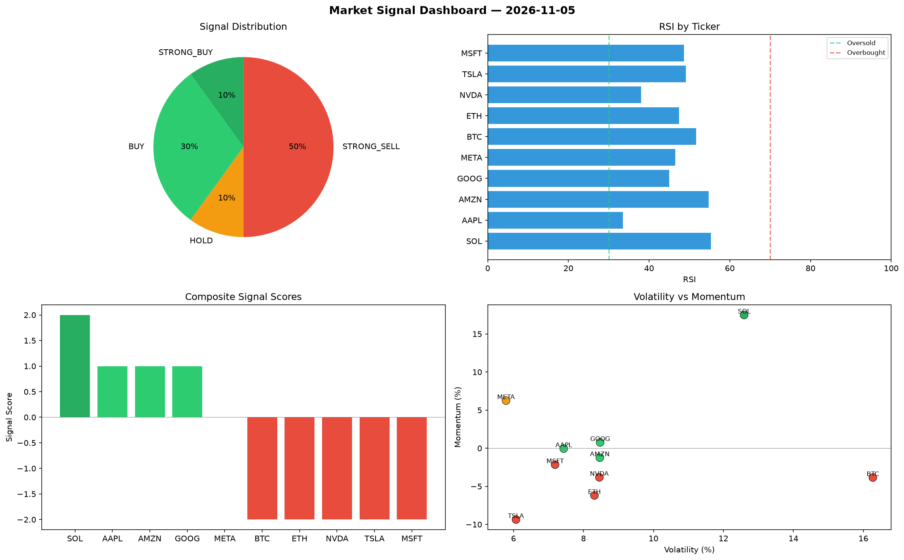

# Market Signal Report — 2026-11-05

**Run ID:** `0a389dde0e` | **Buy:** 4 | **Sell:** 5 | **Hold:** 1

## Signal Dashboard

| Ticker | Price | Signal | Score | RSI | Momentum | Confidence |
|--------|-------|--------|-------|-----|----------|------------|
| SOL | $635.99 | **STRONG_BUY** | 2 | 55.35 | 0.1749 | 0.5 |
| AAPL | $3808.68 | **BUY** | 1 | 33.51 | -0.0005 | 0.25 |
| AMZN | $1919.55 | **BUY** | 1 | 54.72 | -0.0124 | 0.25 |
| GOOG | $3793.56 | **BUY** | 1 | 44.98 | 0.0076 | 0.25 |
| META | $2357.2 | **HOLD** | 0 | 46.51 | 0.0625 | 0.0 |
| BTC | $261.22 | **STRONG_SELL** | -2 | 51.68 | -0.0385 | 0.5 |
| ETH | $3269.06 | **STRONG_SELL** | -2 | 47.46 | -0.062 | 0.5 |
| NVDA | $4923.09 | **STRONG_SELL** | -2 | 38.05 | -0.0382 | 0.5 |
| TSLA | $555.81 | **STRONG_SELL** | -2 | 49.15 | -0.0936 | 0.5 |
| MSFT | $1813.47 | **STRONG_SELL** | -2 | 48.64 | -0.0216 | 0.5 |

## Delta vs Yesterday

| Ticker | Today | Yesterday | Price Change | Signal Changed |
|--------|-------|-----------|-------------|----------------|
| SOL | STRONG_BUY | STRONG_SELL | 📉 -77.64% | ⚠️ YES |
| AAPL | BUY | STRONG_BUY | 📈 18.64% | ⚠️ YES |
| AMZN | BUY | SELL | 📈 25.27% | ⚠️ YES |
| GOOG | BUY | BUY | 📉 -20.78% | — |
| META | HOLD | STRONG_BUY | 📈 7.7% | ⚠️ YES |
| BTC | STRONG_SELL | STRONG_BUY | 📉 -92.61% | ⚠️ YES |
| ETH | STRONG_SELL | STRONG_SELL | 📈 25.44% | — |
| NVDA | STRONG_SELL | STRONG_SELL | 📈 1579.89% | — |
| TSLA | STRONG_SELL | HOLD | 📉 -83.52% | ⚠️ YES |
| MSFT | STRONG_SELL | STRONG_SELL | 📈 275.41% | — |