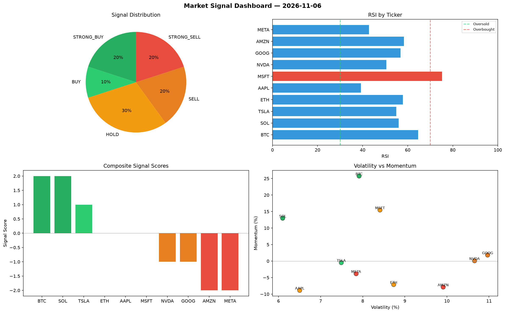

# Market Signal Report — 2026-11-06

**Run ID:** `c3e97f5a51` | **Buy:** 3 | **Sell:** 4 | **Hold:** 3

## Signal Dashboard

| Ticker | Price | Signal | Score | RSI | Momentum | Confidence |
|--------|-------|--------|-------|-----|----------|------------|
| BTC | $4660.68 | **STRONG_BUY** | 2 | 64.66 | 0.2575 | 0.5 |
| SOL | $5266.21 | **STRONG_BUY** | 2 | 56.0 | 0.1298 | 0.5 |
| TSLA | $3998.04 | **BUY** | 1 | 54.91 | -0.0047 | 0.25 |
| ETH | $4217.93 | **HOLD** | 0 | 57.9 | -0.0711 | 0.0 |
| AAPL | $1076.69 | **HOLD** | 0 | 39.25 | -0.0887 | 0.0 |
| MSFT | $4814.15 | **HOLD** | 0 | 75.26 | 0.1546 | 0.0 |
| NVDA | $93.36 | **SELL** | -1 | 50.55 | 0.0009 | 0.25 |
| GOOG | $2905.24 | **SELL** | -1 | 56.82 | 0.0182 | 0.25 |
| AMZN | $2031.03 | **STRONG_SELL** | -2 | 58.34 | -0.0787 | 0.5 |
| META | $3269.82 | **STRONG_SELL** | -2 | 42.85 | -0.0383 | 0.5 |

## Delta vs Yesterday

| Ticker | Today | Yesterday | Price Change | Signal Changed |
|--------|-------|-----------|-------------|----------------|
| BTC | STRONG_BUY | HOLD | 📈 10.76% | ⚠️ YES |
| SOL | STRONG_BUY | HOLD | 📈 343.82% | ⚠️ YES |
| TSLA | BUY | STRONG_BUY | 📈 40.16% | ⚠️ YES |
| ETH | HOLD | STRONG_BUY | 📈 191.68% | ⚠️ YES |
| AAPL | HOLD | STRONG_SELL | 📉 -24.27% | ⚠️ YES |
| MSFT | HOLD | BUY | 📈 962.44% | ⚠️ YES |
| NVDA | SELL | STRONG_SELL | 📉 -96.24% | ⚠️ YES |
| GOOG | SELL | STRONG_SELL | 📉 -26.31% | ⚠️ YES |
| AMZN | STRONG_SELL | SELL | 📈 85.42% | ⚠️ YES |
| META | STRONG_SELL | STRONG_SELL | 📈 60.63% | — |