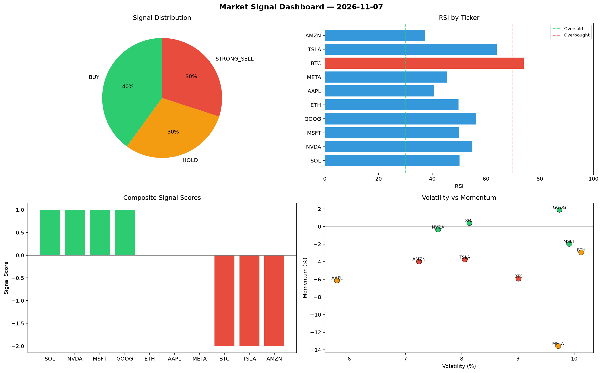

# Market Signal Report — 2026-11-07

**Run ID:** `ca7a7102be` | **Buy:** 4 | **Sell:** 3 | **Hold:** 3

## Signal Dashboard

| Ticker | Price | Signal | Score | RSI | Momentum | Confidence |
|--------|-------|--------|-------|-----|----------|------------|
| SOL | $3940.35 | **BUY** | 1 | 50.16 | 0.004 | 0.25 |
| NVDA | $955.48 | **BUY** | 1 | 54.93 | -0.0034 | 0.25 |
| MSFT | $2443.07 | **BUY** | 1 | 50.09 | -0.0197 | 0.25 |
| GOOG | $2401.03 | **BUY** | 1 | 56.36 | 0.019 | 0.25 |
| ETH | $1425.4 | **HOLD** | 0 | 49.8 | -0.0294 | 0.0 |
| AAPL | $3650.56 | **HOLD** | 0 | 40.63 | -0.0612 | 0.0 |
| META | $3867.71 | **HOLD** | 0 | 45.57 | -0.1357 | 0.0 |
| BTC | $2222.5 | **STRONG_SELL** | -2 | 74.04 | -0.0592 | 0.5 |
| TSLA | $2178.37 | **STRONG_SELL** | -2 | 64.0 | -0.0375 | 0.5 |
| AMZN | $749.34 | **STRONG_SELL** | -2 | 37.25 | -0.0397 | 0.5 |

## Delta vs Yesterday

| Ticker | Today | Yesterday | Price Change | Signal Changed |
|--------|-------|-----------|-------------|----------------|
| SOL | BUY | STRONG_BUY | 📈 31.62% | ⚠️ YES |
| NVDA | BUY | SELL | 📉 -35.31% | ⚠️ YES |
| MSFT | BUY | HOLD | 📉 -45.21% | ⚠️ YES |
| GOOG | BUY | STRONG_BUY | 📉 -53.58% | ⚠️ YES |
| ETH | HOLD | HOLD | 📉 -50.25% | — |
| AAPL | HOLD | HOLD | 📈 48.58% | — |
| META | HOLD | HOLD | 📉 -17.55% | — |
| BTC | STRONG_SELL | STRONG_BUY | 📉 -41.77% | ⚠️ YES |
| TSLA | STRONG_SELL | HOLD | 📈 74.09% | ⚠️ YES |
| AMZN | STRONG_SELL | STRONG_SELL | 📉 -76.32% | — |