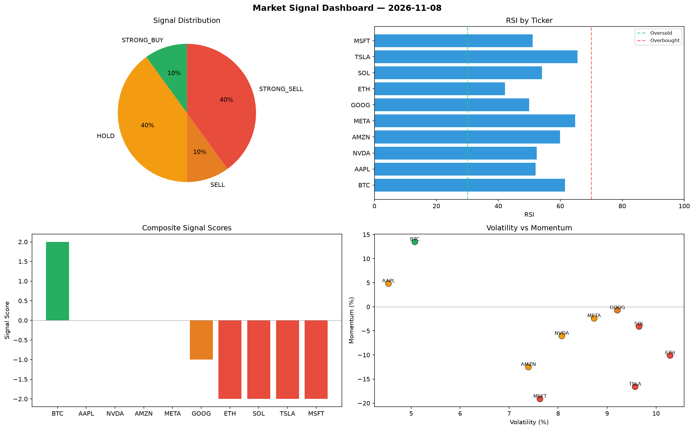

# Market Signal Report — 2026-11-08

**Run ID:** `eb21bb492e` | **Buy:** 1 | **Sell:** 5 | **Hold:** 4

## Signal Dashboard

| Ticker | Price | Signal | Score | RSI | Momentum | Confidence |
|--------|-------|--------|-------|-----|----------|------------|
| BTC | $4656.58 | **STRONG_BUY** | 2 | 61.49 | 0.1348 | 0.5 |
| AAPL | $176.0 | **HOLD** | 0 | 52.06 | 0.0482 | 0.0 |
| NVDA | $3201.36 | **HOLD** | 0 | 52.44 | -0.0604 | 0.0 |
| AMZN | $704.36 | **HOLD** | 0 | 59.91 | -0.1251 | 0.0 |
| META | $4447.75 | **HOLD** | 0 | 64.77 | -0.0241 | 0.0 |
| GOOG | $4847.69 | **SELL** | -1 | 49.97 | -0.0071 | 0.25 |
| ETH | $1846.68 | **STRONG_SELL** | -2 | 42.14 | -0.1011 | 0.5 |
| SOL | $2298.27 | **STRONG_SELL** | -2 | 54.09 | -0.0409 | 0.5 |
| TSLA | $484.03 | **STRONG_SELL** | -2 | 65.53 | -0.1659 | 0.5 |
| MSFT | $2742.46 | **STRONG_SELL** | -2 | 51.11 | -0.1913 | 0.5 |

## Delta vs Yesterday

| Ticker | Today | Yesterday | Price Change | Signal Changed |
|--------|-------|-----------|-------------|----------------|
| BTC | STRONG_BUY | HOLD | 📈 63.52% | ⚠️ YES |
| AAPL | HOLD | STRONG_SELL | 📉 -55.07% | ⚠️ YES |
| NVDA | HOLD | HOLD | 📉 -6.67% | — |
| AMZN | HOLD | HOLD | 📉 -80.33% | — |
| META | HOLD | SELL | 📉 -8.23% | ⚠️ YES |
| GOOG | SELL | STRONG_BUY | 📈 374.69% | ⚠️ YES |
| ETH | STRONG_SELL | STRONG_SELL | 📉 -20.77% | — |
| SOL | STRONG_SELL | STRONG_BUY | 📈 3.82% | ⚠️ YES |
| TSLA | STRONG_SELL | HOLD | 📉 -89.45% | ⚠️ YES |
| MSFT | STRONG_SELL | STRONG_SELL | 📈 78.52% | — |