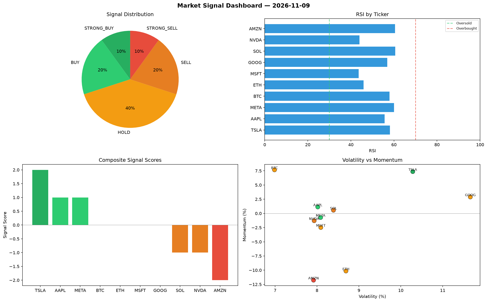

# Market Signal Report — 2026-11-09

**Run ID:** `9914f941e4` | **Buy:** 3 | **Sell:** 3 | **Hold:** 4

## Signal Dashboard

| Ticker | Price | Signal | Score | RSI | Momentum | Confidence |
|--------|-------|--------|-------|-----|----------|------------|
| TSLA | $3948.68 | **STRONG_BUY** | 2 | 58.13 | 0.0736 | 0.5 |
| AAPL | $3588.89 | **BUY** | 1 | 55.62 | 0.0113 | 0.25 |
| META | $393.83 | **BUY** | 1 | 60.0 | -0.0072 | 0.25 |
| BTC | $4282.82 | **HOLD** | 0 | 57.94 | 0.0767 | 0.0 |
| ETH | $1561.25 | **HOLD** | 0 | 45.9 | -0.1015 | 0.0 |
| MSFT | $2803.13 | **HOLD** | 0 | 43.57 | -0.0248 | 0.0 |
| GOOG | $37.76 | **HOLD** | 0 | 56.9 | 0.0289 | 0.0 |
| SOL | $1132.18 | **SELL** | -1 | 60.63 | 0.0056 | 0.25 |
| NVDA | $3372.14 | **SELL** | -1 | 44.04 | -0.0129 | 0.25 |
| AMZN | $1071.41 | **STRONG_SELL** | -2 | 60.55 | -0.1176 | 0.5 |

## Delta vs Yesterday

| Ticker | Today | Yesterday | Price Change | Signal Changed |
|--------|-------|-----------|-------------|----------------|
| TSLA | STRONG_BUY | STRONG_BUY | 📉 -21.95% | — |
| AAPL | BUY | STRONG_SELL | 📉 -25.08% | ⚠️ YES |
| META | BUY | HOLD | 📉 -88.75% | ⚠️ YES |
| BTC | HOLD | HOLD | 📉 -0.59% | — |
| ETH | HOLD | HOLD | 📈 25.92% | — |
| MSFT | HOLD | HOLD | 📈 0.16% | — |
| GOOG | HOLD | STRONG_BUY | 📉 -99.23% | ⚠️ YES |
| SOL | SELL | STRONG_SELL | 📉 -67.62% | ⚠️ YES |
| NVDA | SELL | HOLD | 📉 -7.58% | ⚠️ YES |
| AMZN | STRONG_SELL | STRONG_BUY | 📉 -67.66% | ⚠️ YES |