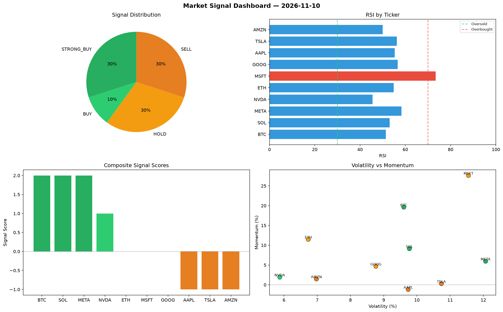

# Market Signal Report — 2026-11-10

**Run ID:** `0fb30711e9` | **Buy:** 4 | **Sell:** 3 | **Hold:** 3

## Signal Dashboard

| Ticker | Price | Signal | Score | RSI | Momentum | Confidence |
|--------|-------|--------|-------|-----|----------|------------|
| BTC | $169.38 | **STRONG_BUY** | 2 | 51.41 | 0.1963 | 0.5 |
| SOL | $2356.5 | **STRONG_BUY** | 2 | 53.08 | 0.0914 | 0.5 |
| META | $2267.2 | **STRONG_BUY** | 2 | 58.3 | 0.0596 | 0.5 |
| NVDA | $1974.58 | **BUY** | 1 | 45.49 | 0.0193 | 0.25 |
| ETH | $2370.33 | **HOLD** | 0 | 54.85 | 0.1149 | 0.0 |
| MSFT | $2174.91 | **HOLD** | 0 | 73.4 | 0.2763 | 0.0 |
| GOOG | $3793.96 | **HOLD** | 0 | 56.59 | 0.0468 | 0.0 |
| AAPL | $1144.63 | **SELL** | -1 | 55.33 | -0.0117 | 0.25 |
| TSLA | $2006.61 | **SELL** | -1 | 56.24 | 0.0029 | 0.25 |
| AMZN | $823.36 | **SELL** | -1 | 50.03 | 0.0148 | 0.25 |

## Delta vs Yesterday

| Ticker | Today | Yesterday | Price Change | Signal Changed |
|--------|-------|-----------|-------------|----------------|
| BTC | STRONG_BUY | STRONG_BUY | 📉 -95.9% | — |
| SOL | STRONG_BUY | STRONG_SELL | 📈 984.79% | ⚠️ YES |
| META | STRONG_BUY | STRONG_SELL | 📉 -1.74% | ⚠️ YES |
| NVDA | BUY | STRONG_BUY | 📈 121.33% | ⚠️ YES |
| ETH | HOLD | STRONG_BUY | 📉 -0.22% | ⚠️ YES |
| MSFT | HOLD | BUY | 📈 42.25% | ⚠️ YES |
| GOOG | HOLD | STRONG_SELL | 📈 180.26% | ⚠️ YES |
| AAPL | SELL | STRONG_SELL | 📉 -61.56% | ⚠️ YES |
| TSLA | SELL | STRONG_BUY | 📈 304.2% | ⚠️ YES |
| AMZN | SELL | SELL | 📉 -46.68% | — |