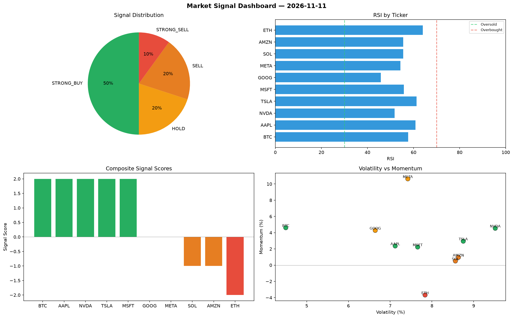

# Market Signal Report — 2026-11-11

**Run ID:** `c3b10575ee` | **Buy:** 5 | **Sell:** 3 | **Hold:** 2

## Signal Dashboard

| Ticker | Price | Signal | Score | RSI | Momentum | Confidence |
|--------|-------|--------|-------|-----|----------|------------|
| BTC | $3940.12 | **STRONG_BUY** | 2 | 57.7 | 0.0461 | 0.5 |
| AAPL | $370.78 | **STRONG_BUY** | 2 | 60.85 | 0.0236 | 0.5 |
| NVDA | $1262.25 | **STRONG_BUY** | 2 | 51.76 | 0.0454 | 0.5 |
| TSLA | $4605.16 | **STRONG_BUY** | 2 | 61.32 | 0.0295 | 0.5 |
| MSFT | $2236.34 | **STRONG_BUY** | 2 | 55.81 | 0.0223 | 0.5 |
| GOOG | $1458.74 | **HOLD** | 0 | 45.81 | 0.0428 | 0.0 |
| META | $928.63 | **HOLD** | 0 | 54.31 | 0.1063 | 0.0 |
| SOL | $3507.54 | **SELL** | -1 | 55.48 | 0.0051 | 0.25 |
| AMZN | $1655.07 | **SELL** | -1 | 55.53 | 0.0096 | 0.25 |
| ETH | $4077.34 | **STRONG_SELL** | -2 | 63.99 | -0.0368 | 0.5 |

## Delta vs Yesterday

| Ticker | Today | Yesterday | Price Change | Signal Changed |
|--------|-------|-----------|-------------|----------------|
| BTC | STRONG_BUY | STRONG_BUY | 📈 2226.2% | — |
| AAPL | STRONG_BUY | SELL | 📉 -67.61% | ⚠️ YES |
| NVDA | STRONG_BUY | BUY | 📉 -36.08% | ⚠️ YES |
| TSLA | STRONG_BUY | SELL | 📈 129.5% | ⚠️ YES |
| MSFT | STRONG_BUY | HOLD | 📈 2.82% | ⚠️ YES |
| GOOG | HOLD | HOLD | 📉 -61.55% | — |
| META | HOLD | STRONG_BUY | 📉 -59.04% | ⚠️ YES |
| SOL | SELL | STRONG_BUY | 📈 48.85% | ⚠️ YES |
| AMZN | SELL | SELL | 📈 101.01% | — |
| ETH | STRONG_SELL | HOLD | 📈 72.02% | ⚠️ YES |