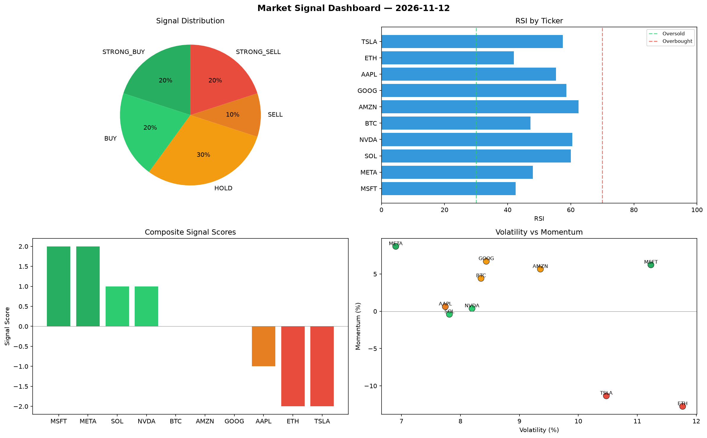

# Market Signal Report — 2026-11-12

**Run ID:** `776813bfd0` | **Buy:** 4 | **Sell:** 3 | **Hold:** 3

## Signal Dashboard

| Ticker | Price | Signal | Score | RSI | Momentum | Confidence |
|--------|-------|--------|-------|-----|----------|------------|
| MSFT | $2088.32 | **STRONG_BUY** | 2 | 42.57 | 0.0623 | 0.5 |
| META | $4010.71 | **STRONG_BUY** | 2 | 48.02 | 0.0871 | 0.5 |
| SOL | $3086.18 | **BUY** | 1 | 60.02 | -0.004 | 0.25 |
| NVDA | $4516.7 | **BUY** | 1 | 60.5 | 0.0038 | 0.25 |
| BTC | $1511.62 | **HOLD** | 0 | 47.22 | 0.0442 | 0.0 |
| AMZN | $3273.78 | **HOLD** | 0 | 62.49 | 0.0566 | 0.0 |
| GOOG | $5116.86 | **HOLD** | 0 | 58.61 | 0.0671 | 0.0 |
| AAPL | $2865.14 | **SELL** | -1 | 55.31 | 0.0063 | 0.25 |
| ETH | $657.65 | **STRONG_SELL** | -2 | 42.0 | -0.1275 | 0.5 |
| TSLA | $119.75 | **STRONG_SELL** | -2 | 57.53 | -0.1134 | 0.5 |

## Delta vs Yesterday

| Ticker | Today | Yesterday | Price Change | Signal Changed |
|--------|-------|-----------|-------------|----------------|
| MSFT | STRONG_BUY | STRONG_BUY | 📈 1169.88% | — |
| META | STRONG_BUY | HOLD | 📈 1.08% | ⚠️ YES |
| SOL | BUY | STRONG_BUY | 📈 80.75% | ⚠️ YES |
| NVDA | BUY | STRONG_BUY | 📈 11.57% | ⚠️ YES |
| BTC | HOLD | STRONG_SELL | 📈 1762.75% | ⚠️ YES |
| AMZN | HOLD | HOLD | 📈 43.46% | — |
| GOOG | HOLD | SELL | 📈 407.96% | ⚠️ YES |
| AAPL | SELL | STRONG_BUY | 📈 15.23% | ⚠️ YES |
| ETH | STRONG_SELL | HOLD | 📉 -14.71% | ⚠️ YES |
| TSLA | STRONG_SELL | STRONG_SELL | 📉 -97.16% | — |