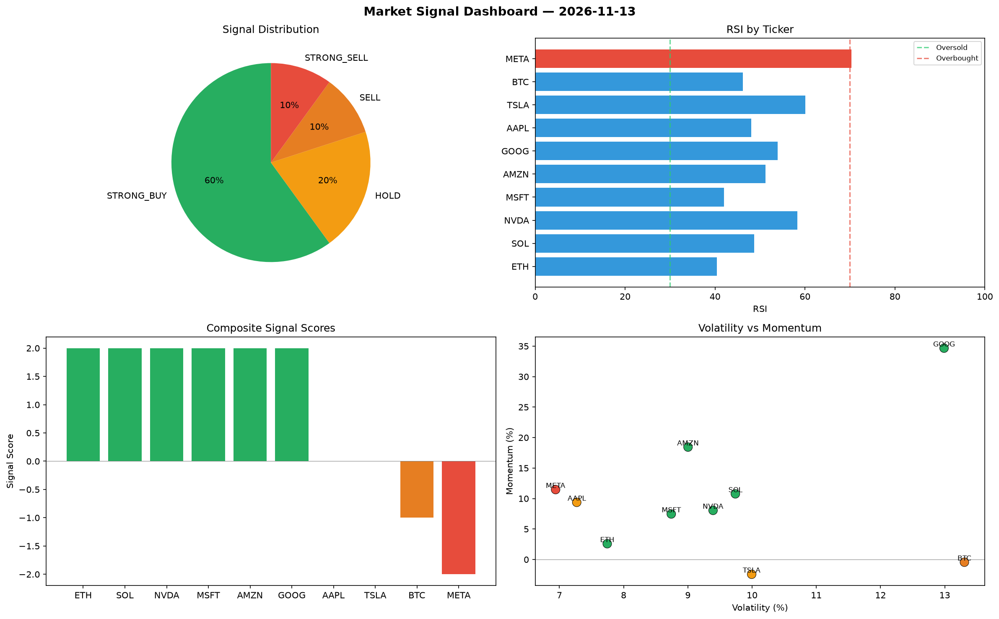

# Market Signal Report — 2026-11-13

**Run ID:** `6864800d89` | **Buy:** 6 | **Sell:** 2 | **Hold:** 2

## Signal Dashboard

| Ticker | Price | Signal | Score | RSI | Momentum | Confidence |
|--------|-------|--------|-------|-----|----------|------------|
| ETH | $1454.5 | **STRONG_BUY** | 2 | 40.43 | 0.0259 | 0.5 |
| SOL | $272.14 | **STRONG_BUY** | 2 | 48.73 | 0.1077 | 0.5 |
| NVDA | $2154.0 | **STRONG_BUY** | 2 | 58.28 | 0.0806 | 0.5 |
| MSFT | $1508.32 | **STRONG_BUY** | 2 | 41.95 | 0.0747 | 0.5 |
| AMZN | $575.87 | **STRONG_BUY** | 2 | 51.23 | 0.1844 | 0.5 |
| GOOG | $1876.38 | **STRONG_BUY** | 2 | 53.93 | 0.3467 | 0.5 |
| AAPL | $1898.76 | **HOLD** | 0 | 48.08 | 0.0938 | 0.0 |
| TSLA | $4795.81 | **HOLD** | 0 | 60.09 | -0.0242 | 0.0 |
| BTC | $4277.93 | **SELL** | -1 | 46.21 | -0.0044 | 0.25 |
| META | $4957.37 | **STRONG_SELL** | -2 | 70.32 | 0.1147 | 0.5 |

## Delta vs Yesterday

| Ticker | Today | Yesterday | Price Change | Signal Changed |
|--------|-------|-----------|-------------|----------------|
| ETH | STRONG_BUY | STRONG_SELL | 📉 -27.53% | ⚠️ YES |
| SOL | STRONG_BUY | STRONG_BUY | 📉 -76.41% | — |
| NVDA | STRONG_BUY | STRONG_SELL | 📈 23.1% | ⚠️ YES |
| MSFT | STRONG_BUY | STRONG_BUY | 📉 -45.21% | — |
| AMZN | STRONG_BUY | HOLD | 📉 -68.84% | ⚠️ YES |
| GOOG | STRONG_BUY | BUY | 📉 -29.42% | ⚠️ YES |
| AAPL | HOLD | STRONG_BUY | 📈 59.77% | ⚠️ YES |
| TSLA | HOLD | HOLD | 📈 5.9% | — |
| BTC | SELL | HOLD | 📈 171.54% | ⚠️ YES |
| META | STRONG_SELL | STRONG_BUY | 📈 60.17% | ⚠️ YES |