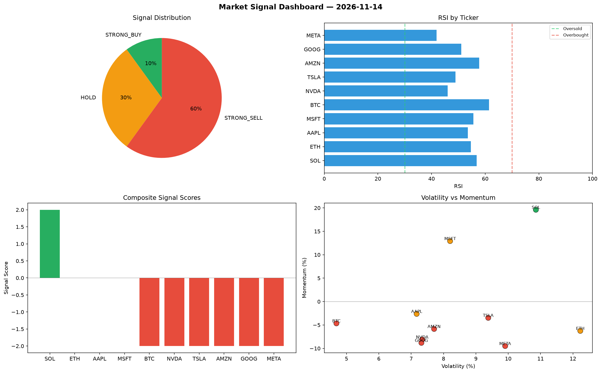

# Market Signal Report — 2026-11-14

**Run ID:** `31e3957b30` | **Buy:** 1 | **Sell:** 6 | **Hold:** 3

## Signal Dashboard

| Ticker | Price | Signal | Score | RSI | Momentum | Confidence |
|--------|-------|--------|-------|-----|----------|------------|
| SOL | $5166.1 | **STRONG_BUY** | 2 | 56.79 | 0.196 | 0.5 |
| ETH | $2463.18 | **HOLD** | 0 | 54.67 | -0.0626 | 0.0 |
| AAPL | $1188.94 | **HOLD** | 0 | 53.57 | -0.0263 | 0.0 |
| MSFT | $598.37 | **HOLD** | 0 | 55.6 | 0.1292 | 0.0 |
| BTC | $4866.65 | **STRONG_SELL** | -2 | 61.45 | -0.0466 | 0.5 |
| NVDA | $484.18 | **STRONG_SELL** | -2 | 46.04 | -0.0811 | 0.5 |
| TSLA | $3218.91 | **STRONG_SELL** | -2 | 48.95 | -0.0348 | 0.5 |
| AMZN | $649.0 | **STRONG_SELL** | -2 | 57.76 | -0.0585 | 0.5 |
| GOOG | $1872.34 | **STRONG_SELL** | -2 | 51.08 | -0.0882 | 0.5 |
| META | $1929.36 | **STRONG_SELL** | -2 | 41.89 | -0.095 | 0.5 |

## Delta vs Yesterday

| Ticker | Today | Yesterday | Price Change | Signal Changed |
|--------|-------|-----------|-------------|----------------|
| SOL | STRONG_BUY | STRONG_SELL | 📈 45.09% | ⚠️ YES |
| ETH | HOLD | STRONG_SELL | 📉 -5.02% | ⚠️ YES |
| AAPL | HOLD | STRONG_BUY | 📉 -62.46% | ⚠️ YES |
| MSFT | HOLD | STRONG_SELL | 📉 -79.7% | ⚠️ YES |
| BTC | STRONG_SELL | HOLD | 📈 29.99% | ⚠️ YES |
| NVDA | STRONG_SELL | STRONG_BUY | 📉 -86.65% | ⚠️ YES |
| TSLA | STRONG_SELL | SELL | 📈 68.43% | ⚠️ YES |
| AMZN | STRONG_SELL | SELL | 📉 -71.83% | ⚠️ YES |
| GOOG | STRONG_SELL | HOLD | 📉 -45.63% | ⚠️ YES |
| META | STRONG_SELL | STRONG_BUY | 📈 299.18% | ⚠️ YES |