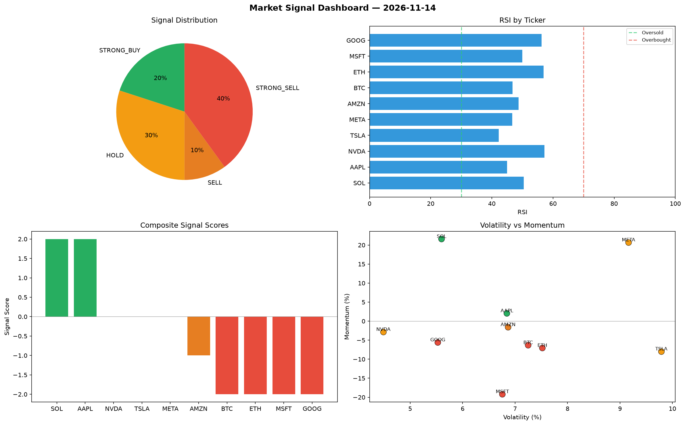

# Market Signal Report — 2026-11-14

**Run ID:** `750e53ad97` | **Buy:** 2 | **Sell:** 5 | **Hold:** 3

## Signal Dashboard

| Ticker | Price | Signal | Score | RSI | Momentum | Confidence |
|--------|-------|--------|-------|-----|----------|------------|
| SOL | $1090.41 | **STRONG_BUY** | 2 | 50.41 | 0.2158 | 0.5 |
| AAPL | $1254.43 | **STRONG_BUY** | 2 | 44.96 | 0.0204 | 0.5 |
| NVDA | $1430.76 | **HOLD** | 0 | 57.22 | -0.0286 | 0.0 |
| TSLA | $3287.14 | **HOLD** | 0 | 42.28 | -0.08 | 0.0 |
| META | $796.58 | **HOLD** | 0 | 46.69 | 0.2066 | 0.0 |
| AMZN | $1604.69 | **SELL** | -1 | 48.71 | -0.016 | 0.25 |
| BTC | $1869.08 | **STRONG_SELL** | -2 | 46.73 | -0.0633 | 0.5 |
| ETH | $1136.11 | **STRONG_SELL** | -2 | 56.96 | -0.0706 | 0.5 |
| MSFT | $1450.0 | **STRONG_SELL** | -2 | 49.97 | -0.1922 | 0.5 |
| GOOG | $2947.02 | **STRONG_SELL** | -2 | 56.25 | -0.056 | 0.5 |

## Delta vs Yesterday

| Ticker | Today | Yesterday | Price Change | Signal Changed |
|--------|-------|-----------|-------------|----------------|
| SOL | STRONG_BUY | STRONG_SELL | 📉 -69.38% | ⚠️ YES |
| AAPL | STRONG_BUY | STRONG_BUY | 📉 -60.4% | — |
| NVDA | HOLD | STRONG_BUY | 📉 -60.54% | ⚠️ YES |
| TSLA | HOLD | SELL | 📈 72.0% | ⚠️ YES |
| META | HOLD | STRONG_BUY | 📈 64.81% | ⚠️ YES |
| AMZN | SELL | SELL | 📉 -30.35% | — |
| BTC | STRONG_SELL | HOLD | 📉 -50.08% | ⚠️ YES |
| ETH | STRONG_SELL | STRONG_SELL | 📉 -56.19% | — |
| MSFT | STRONG_SELL | STRONG_SELL | 📉 -50.81% | — |
| GOOG | STRONG_SELL | HOLD | 📉 -14.43% | ⚠️ YES |