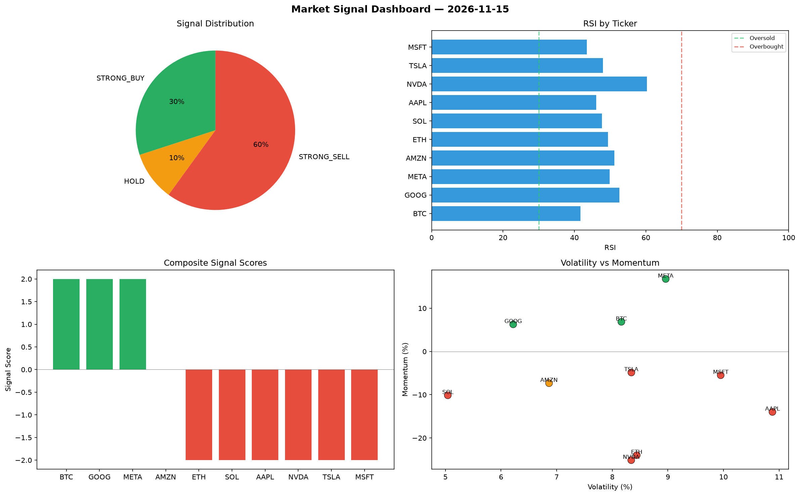

# Market Signal Report — 2026-11-15

**Run ID:** `6566e1fd4d` | **Buy:** 3 | **Sell:** 6 | **Hold:** 1

## Signal Dashboard

| Ticker | Price | Signal | Score | RSI | Momentum | Confidence |
|--------|-------|--------|-------|-----|----------|------------|
| BTC | $2266.7 | **STRONG_BUY** | 2 | 41.67 | 0.0686 | 0.5 |
| GOOG | $1514.11 | **STRONG_BUY** | 2 | 52.63 | 0.0628 | 0.5 |
| META | $3148.6 | **STRONG_BUY** | 2 | 49.85 | 0.1677 | 0.5 |
| AMZN | $675.19 | **HOLD** | 0 | 51.16 | -0.0733 | 0.0 |
| ETH | $316.21 | **STRONG_SELL** | -2 | 49.41 | -0.2398 | 0.5 |
| SOL | $2087.97 | **STRONG_SELL** | -2 | 47.69 | -0.1013 | 0.5 |
| AAPL | $1192.26 | **STRONG_SELL** | -2 | 46.13 | -0.1398 | 0.5 |
| NVDA | $3845.02 | **STRONG_SELL** | -2 | 60.26 | -0.2513 | 0.5 |
| TSLA | $1873.21 | **STRONG_SELL** | -2 | 48.0 | -0.0486 | 0.5 |
| MSFT | $776.13 | **STRONG_SELL** | -2 | 43.47 | -0.0549 | 0.5 |

## Delta vs Yesterday

| Ticker | Today | Yesterday | Price Change | Signal Changed |
|--------|-------|-----------|-------------|----------------|
| BTC | STRONG_BUY | STRONG_SELL | 📈 21.27% | ⚠️ YES |
| GOOG | STRONG_BUY | STRONG_SELL | 📉 -48.62% | ⚠️ YES |
| META | STRONG_BUY | HOLD | 📈 295.26% | ⚠️ YES |
| AMZN | HOLD | SELL | 📉 -57.92% | ⚠️ YES |
| ETH | STRONG_SELL | STRONG_SELL | 📉 -72.17% | — |
| SOL | STRONG_SELL | STRONG_BUY | 📈 91.48% | ⚠️ YES |
| AAPL | STRONG_SELL | STRONG_BUY | 📉 -4.96% | ⚠️ YES |
| NVDA | STRONG_SELL | HOLD | 📈 168.74% | ⚠️ YES |
| TSLA | STRONG_SELL | HOLD | 📉 -43.01% | ⚠️ YES |
| MSFT | STRONG_SELL | STRONG_SELL | 📉 -46.47% | — |