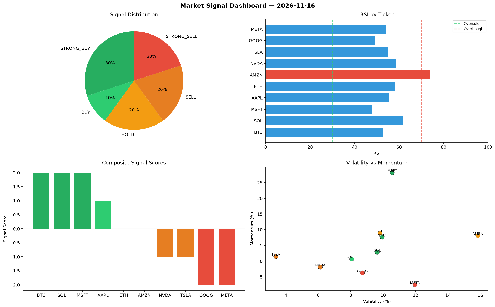

# Market Signal Report — 2026-11-16

**Run ID:** `c46d714938` | **Buy:** 4 | **Sell:** 4 | **Hold:** 2

## Signal Dashboard

| Ticker | Price | Signal | Score | RSI | Momentum | Confidence |
|--------|-------|--------|-------|-----|----------|------------|
| BTC | $4027.0 | **STRONG_BUY** | 2 | 52.81 | 0.076 | 0.5 |
| SOL | $661.85 | **STRONG_BUY** | 2 | 61.73 | 0.0281 | 0.5 |
| MSFT | $1139.34 | **STRONG_BUY** | 2 | 47.82 | 0.2816 | 0.5 |
| AAPL | $2397.71 | **BUY** | 1 | 55.38 | 0.0065 | 0.25 |
| ETH | $3989.1 | **HOLD** | 0 | 58.24 | 0.0893 | 0.0 |
| AMZN | $2615.91 | **HOLD** | 0 | 74.13 | 0.081 | 0.0 |
| NVDA | $1156.29 | **SELL** | -1 | 58.79 | -0.0193 | 0.25 |
| TSLA | $1504.36 | **SELL** | -1 | 55.08 | 0.0147 | 0.25 |
| GOOG | $1113.03 | **STRONG_SELL** | -2 | 49.21 | -0.0377 | 0.5 |
| META | $297.88 | **STRONG_SELL** | -2 | 54.02 | -0.0755 | 0.5 |

## Delta vs Yesterday

| Ticker | Today | Yesterday | Price Change | Signal Changed |
|--------|-------|-----------|-------------|----------------|
| BTC | STRONG_BUY | STRONG_SELL | 📈 1129.58% | ⚠️ YES |
| SOL | STRONG_BUY | HOLD | 📉 -60.31% | ⚠️ YES |
| MSFT | STRONG_BUY | STRONG_SELL | 📉 -66.42% | ⚠️ YES |
| AAPL | BUY | STRONG_SELL | 📈 82.03% | ⚠️ YES |
| ETH | HOLD | HOLD | 📈 21254.93% | — |
| AMZN | HOLD | BUY | 📉 -27.5% | ⚠️ YES |
| NVDA | SELL | STRONG_BUY | 📉 -78.99% | ⚠️ YES |
| TSLA | SELL | STRONG_SELL | 📉 -47.23% | ⚠️ YES |
| GOOG | STRONG_SELL | BUY | 📉 -42.0% | ⚠️ YES |
| META | STRONG_SELL | STRONG_SELL | 📉 -88.63% | — |