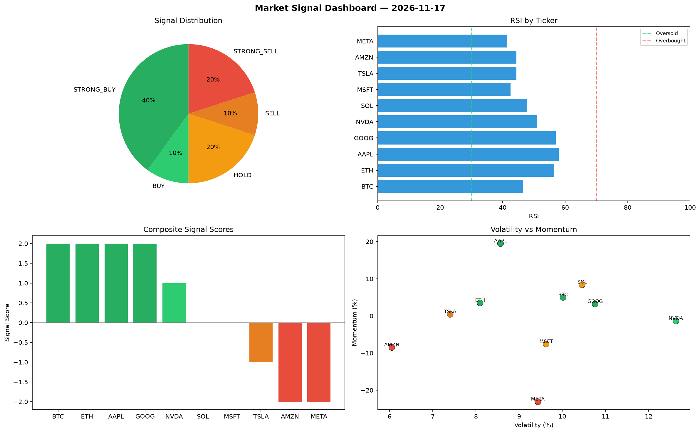

# Market Signal Report — 2026-11-17

**Run ID:** `7a66a01ddc` | **Buy:** 5 | **Sell:** 3 | **Hold:** 2

## Signal Dashboard

| Ticker | Price | Signal | Score | RSI | Momentum | Confidence |
|--------|-------|--------|-------|-----|----------|------------|
| BTC | $1772.55 | **STRONG_BUY** | 2 | 46.6 | 0.0498 | 0.5 |
| ETH | $1241.43 | **STRONG_BUY** | 2 | 56.44 | 0.0349 | 0.5 |
| AAPL | $4804.21 | **STRONG_BUY** | 2 | 57.91 | 0.1949 | 0.5 |
| GOOG | $3223.59 | **STRONG_BUY** | 2 | 57.02 | 0.0319 | 0.5 |
| NVDA | $4806.1 | **BUY** | 1 | 51.0 | -0.0139 | 0.25 |
| SOL | $5052.87 | **HOLD** | 0 | 47.92 | 0.0841 | 0.0 |
| MSFT | $2916.15 | **HOLD** | 0 | 42.5 | -0.076 | 0.0 |
| TSLA | $452.15 | **SELL** | -1 | 44.44 | 0.0043 | 0.25 |
| AMZN | $3902.19 | **STRONG_SELL** | -2 | 44.38 | -0.0849 | 0.5 |
| META | $2445.79 | **STRONG_SELL** | -2 | 41.49 | -0.231 | 0.5 |

## Delta vs Yesterday

| Ticker | Today | Yesterday | Price Change | Signal Changed |
|--------|-------|-----------|-------------|----------------|
| BTC | STRONG_BUY | STRONG_BUY | 📉 -55.98% | — |
| ETH | STRONG_BUY | HOLD | 📉 -68.88% | ⚠️ YES |
| AAPL | STRONG_BUY | BUY | 📈 100.37% | ⚠️ YES |
| GOOG | STRONG_BUY | STRONG_SELL | 📈 189.62% | ⚠️ YES |
| NVDA | BUY | SELL | 📈 315.65% | ⚠️ YES |
| SOL | HOLD | STRONG_BUY | 📈 663.45% | ⚠️ YES |
| MSFT | HOLD | STRONG_BUY | 📈 155.95% | ⚠️ YES |
| TSLA | SELL | SELL | 📉 -69.94% | — |
| AMZN | STRONG_SELL | HOLD | 📈 49.17% | ⚠️ YES |
| META | STRONG_SELL | STRONG_SELL | 📈 721.07% | — |