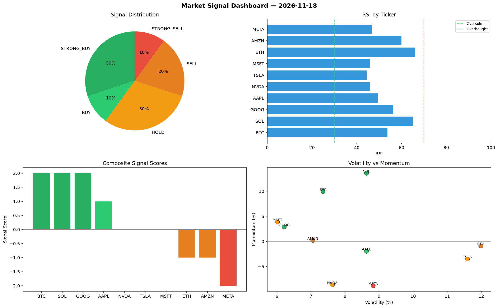

# Market Signal Report — 2026-11-18

**Run ID:** `f8336a062f` | **Buy:** 4 | **Sell:** 3 | **Hold:** 3

## Signal Dashboard

| Ticker | Price | Signal | Score | RSI | Momentum | Confidence |
|--------|-------|--------|-------|-----|----------|------------|
| BTC | $2232.92 | **STRONG_BUY** | 2 | 53.74 | 0.0992 | 0.5 |
| SOL | $1600.94 | **STRONG_BUY** | 2 | 65.13 | 0.1358 | 0.5 |
| GOOG | $3197.35 | **STRONG_BUY** | 2 | 56.38 | 0.0288 | 0.5 |
| AAPL | $4683.51 | **BUY** | 1 | 49.42 | -0.0196 | 0.25 |
| NVDA | $2061.34 | **HOLD** | 0 | 45.91 | -0.0864 | 0.0 |
| TSLA | $5030.64 | **HOLD** | 0 | 44.53 | -0.0349 | 0.0 |
| MSFT | $4378.31 | **HOLD** | 0 | 45.91 | 0.0389 | 0.0 |
| ETH | $134.43 | **SELL** | -1 | 66.15 | -0.009 | 0.25 |
| AMZN | $3150.6 | **SELL** | -1 | 60.03 | 0.0019 | 0.25 |
| META | $3314.04 | **STRONG_SELL** | -2 | 46.7 | -0.0882 | 0.5 |

## Delta vs Yesterday

| Ticker | Today | Yesterday | Price Change | Signal Changed |
|--------|-------|-----------|-------------|----------------|
| BTC | STRONG_BUY | HOLD | 📉 -55.65% | ⚠️ YES |
| SOL | STRONG_BUY | STRONG_BUY | 📉 -67.45% | — |
| GOOG | STRONG_BUY | BUY | 📉 -32.59% | ⚠️ YES |
| AAPL | BUY | STRONG_SELL | 📈 1.58% | ⚠️ YES |
| NVDA | HOLD | STRONG_SELL | 📈 601.9% | ⚠️ YES |
| TSLA | HOLD | STRONG_SELL | 📈 49.18% | ⚠️ YES |
| MSFT | HOLD | HOLD | 📈 499.66% | — |
| ETH | SELL | BUY | 📉 -97.03% | ⚠️ YES |
| AMZN | SELL | HOLD | 📈 129.8% | ⚠️ YES |
| META | STRONG_SELL | SELL | 📈 324.98% | ⚠️ YES |