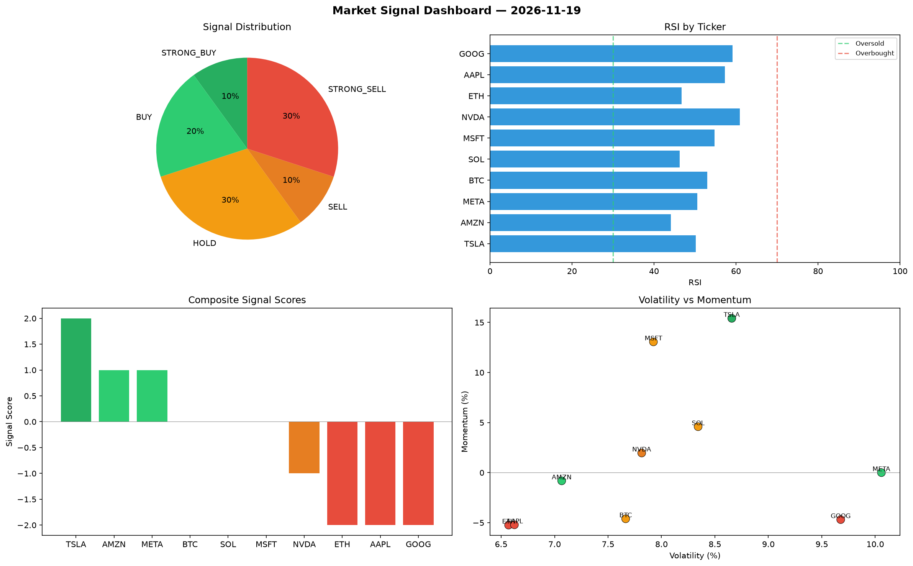

# Market Signal Report — 2026-11-19

**Run ID:** `1069feec53` | **Buy:** 3 | **Sell:** 4 | **Hold:** 3

## Signal Dashboard

| Ticker | Price | Signal | Score | RSI | Momentum | Confidence |
|--------|-------|--------|-------|-----|----------|------------|
| TSLA | $328.49 | **STRONG_BUY** | 2 | 50.21 | 0.1541 | 0.5 |
| AMZN | $4313.02 | **BUY** | 1 | 44.1 | -0.0082 | 0.25 |
| META | $68.49 | **BUY** | 1 | 50.58 | 0.0 | 0.25 |
| BTC | $1229.24 | **HOLD** | 0 | 52.99 | -0.0461 | 0.0 |
| SOL | $1809.07 | **HOLD** | 0 | 46.24 | 0.0459 | 0.0 |
| MSFT | $1711.92 | **HOLD** | 0 | 54.8 | 0.1306 | 0.0 |
| NVDA | $169.68 | **SELL** | -1 | 60.91 | 0.0196 | 0.25 |
| ETH | $3294.81 | **STRONG_SELL** | -2 | 46.7 | -0.0524 | 0.5 |
| AAPL | $2727.96 | **STRONG_SELL** | -2 | 57.28 | -0.0521 | 0.5 |
| GOOG | $4626.3 | **STRONG_SELL** | -2 | 59.11 | -0.0469 | 0.5 |

## Delta vs Yesterday

| Ticker | Today | Yesterday | Price Change | Signal Changed |
|--------|-------|-----------|-------------|----------------|
| TSLA | STRONG_BUY | STRONG_BUY | 📉 -92.24% | — |
| AMZN | BUY | STRONG_BUY | 📉 -12.61% | ⚠️ YES |
| META | BUY | SELL | 📉 -87.4% | ⚠️ YES |
| BTC | HOLD | BUY | 📉 -71.72% | ⚠️ YES |
| SOL | HOLD | STRONG_SELL | 📈 42.52% | ⚠️ YES |
| MSFT | HOLD | STRONG_BUY | 📈 264.53% | ⚠️ YES |
| NVDA | SELL | HOLD | 📉 -96.13% | ⚠️ YES |
| ETH | STRONG_SELL | STRONG_BUY | 📈 6.41% | ⚠️ YES |
| AAPL | STRONG_SELL | HOLD | 📉 -32.73% | ⚠️ YES |
| GOOG | STRONG_SELL | BUY | 📈 8.12% | ⚠️ YES |