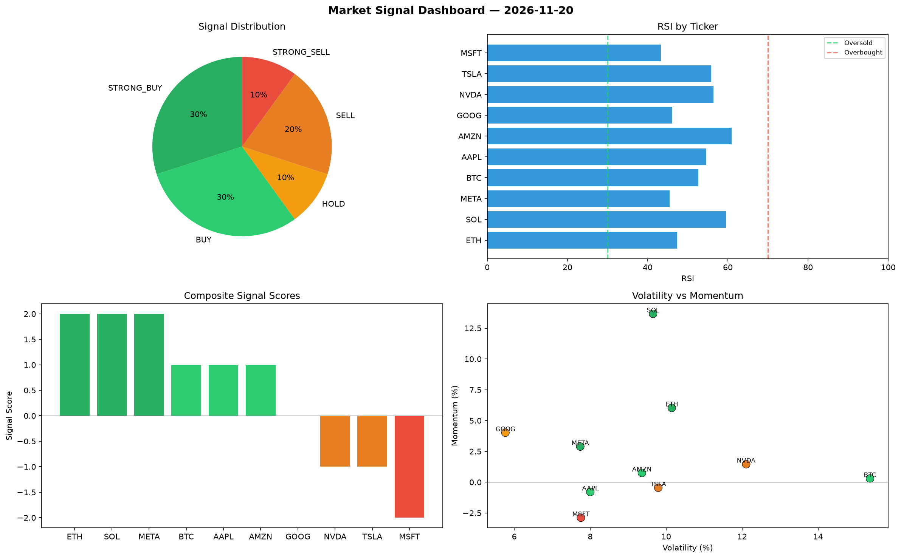

# Market Signal Report — 2026-11-20

**Run ID:** `caedd25c4c` | **Buy:** 6 | **Sell:** 3 | **Hold:** 1

## Signal Dashboard

| Ticker | Price | Signal | Score | RSI | Momentum | Confidence |
|--------|-------|--------|-------|-----|----------|------------|
| ETH | $3586.71 | **STRONG_BUY** | 2 | 47.38 | 0.0603 | 0.5 |
| SOL | $2183.31 | **STRONG_BUY** | 2 | 59.53 | 0.1366 | 0.5 |
| META | $1796.06 | **STRONG_BUY** | 2 | 45.5 | 0.0289 | 0.5 |
| BTC | $3901.71 | **BUY** | 1 | 52.67 | 0.003 | 0.25 |
| AAPL | $3702.29 | **BUY** | 1 | 54.6 | -0.0079 | 0.25 |
| AMZN | $4230.09 | **BUY** | 1 | 60.99 | 0.0075 | 0.25 |
| GOOG | $3225.03 | **HOLD** | 0 | 46.17 | 0.0402 | 0.0 |
| NVDA | $1410.88 | **SELL** | -1 | 56.4 | 0.0146 | 0.25 |
| TSLA | $1151.36 | **SELL** | -1 | 55.81 | -0.0045 | 0.25 |
| MSFT | $2230.21 | **STRONG_SELL** | -2 | 43.29 | -0.0288 | 0.5 |

## Delta vs Yesterday

| Ticker | Today | Yesterday | Price Change | Signal Changed |
|--------|-------|-----------|-------------|----------------|
| ETH | STRONG_BUY | STRONG_SELL | 📈 8.86% | ⚠️ YES |
| SOL | STRONG_BUY | HOLD | 📈 20.69% | ⚠️ YES |
| META | STRONG_BUY | BUY | 📈 2522.37% | ⚠️ YES |
| BTC | BUY | HOLD | 📈 217.41% | ⚠️ YES |
| AAPL | BUY | STRONG_SELL | 📈 35.72% | ⚠️ YES |
| AMZN | BUY | BUY | 📉 -1.92% | — |
| GOOG | HOLD | STRONG_SELL | 📉 -30.29% | ⚠️ YES |
| NVDA | SELL | SELL | 📈 731.49% | — |
| TSLA | SELL | STRONG_BUY | 📈 250.5% | ⚠️ YES |
| MSFT | STRONG_SELL | HOLD | 📈 30.28% | ⚠️ YES |