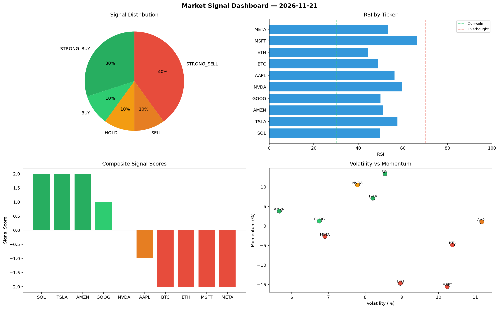

# Market Signal Report — 2026-11-21

**Run ID:** `992bb8a678` | **Buy:** 4 | **Sell:** 5 | **Hold:** 1

## Signal Dashboard

| Ticker | Price | Signal | Score | RSI | Momentum | Confidence |
|--------|-------|--------|-------|-----|----------|------------|
| SOL | $4034.27 | **STRONG_BUY** | 2 | 49.79 | 0.1335 | 0.5 |
| TSLA | $4337.5 | **STRONG_BUY** | 2 | 57.59 | 0.071 | 0.5 |
| AMZN | $3573.79 | **STRONG_BUY** | 2 | 51.23 | 0.0378 | 0.5 |
| GOOG | $4346.89 | **BUY** | 1 | 49.94 | 0.0125 | 0.25 |
| NVDA | $1374.07 | **HOLD** | 0 | 59.47 | 0.105 | 0.0 |
| AAPL | $3209.38 | **SELL** | -1 | 56.29 | 0.0106 | 0.25 |
| BTC | $1455.98 | **STRONG_SELL** | -2 | 48.84 | -0.0486 | 0.5 |
| ETH | $4134.42 | **STRONG_SELL** | -2 | 44.45 | -0.1468 | 0.5 |
| MSFT | $1841.32 | **STRONG_SELL** | -2 | 66.29 | -0.1554 | 0.5 |
| META | $2947.3 | **STRONG_SELL** | -2 | 53.39 | -0.0269 | 0.5 |

## Delta vs Yesterday

| Ticker | Today | Yesterday | Price Change | Signal Changed |
|--------|-------|-----------|-------------|----------------|
| SOL | STRONG_BUY | HOLD | 📈 350.91% | ⚠️ YES |
| TSLA | STRONG_BUY | STRONG_BUY | 📈 140.34% | — |
| AMZN | STRONG_BUY | STRONG_BUY | 📈 597.5% | — |
| GOOG | BUY | HOLD | 📈 7.87% | ⚠️ YES |
| NVDA | HOLD | HOLD | 📈 12.58% | — |
| AAPL | SELL | STRONG_BUY | 📈 3.27% | ⚠️ YES |
| BTC | STRONG_SELL | STRONG_SELL | 📉 -35.04% | — |
| ETH | STRONG_SELL | STRONG_SELL | 📈 167.77% | — |
| MSFT | STRONG_SELL | STRONG_BUY | 📈 61.17% | ⚠️ YES |
| META | STRONG_SELL | STRONG_SELL | 📉 -0.62% | — |