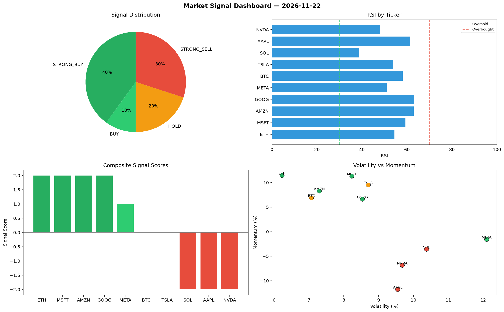

# Market Signal Report — 2026-11-22

**Run ID:** `a67e181f4a` | **Buy:** 5 | **Sell:** 3 | **Hold:** 2

## Signal Dashboard

| Ticker | Price | Signal | Score | RSI | Momentum | Confidence |
|--------|-------|--------|-------|-----|----------|------------|
| ETH | $1589.02 | **STRONG_BUY** | 2 | 54.5 | 0.1145 | 0.5 |
| MSFT | $3121.32 | **STRONG_BUY** | 2 | 59.41 | 0.1131 | 0.5 |
| AMZN | $4592.08 | **STRONG_BUY** | 2 | 63.04 | 0.0828 | 0.5 |
| GOOG | $107.64 | **STRONG_BUY** | 2 | 63.19 | 0.0661 | 0.5 |
| META | $1515.78 | **BUY** | 1 | 51.01 | -0.0158 | 0.25 |
| BTC | $3060.18 | **HOLD** | 0 | 58.12 | 0.069 | 0.0 |
| TSLA | $4199.79 | **HOLD** | 0 | 53.81 | 0.0951 | 0.0 |
| SOL | $3902.66 | **STRONG_SELL** | -2 | 38.8 | -0.0359 | 0.5 |
| AAPL | $980.34 | **STRONG_SELL** | -2 | 61.43 | -0.1178 | 0.5 |
| NVDA | $1085.21 | **STRONG_SELL** | -2 | 48.16 | -0.0686 | 0.5 |

## Delta vs Yesterday

| Ticker | Today | Yesterday | Price Change | Signal Changed |
|--------|-------|-----------|-------------|----------------|
| ETH | STRONG_BUY | SELL | 📈 8.16% | ⚠️ YES |
| MSFT | STRONG_BUY | STRONG_BUY | 📉 -39.2% | — |
| AMZN | STRONG_BUY | SELL | 📈 4.59% | ⚠️ YES |
| GOOG | STRONG_BUY | STRONG_SELL | 📉 -87.56% | ⚠️ YES |
| META | BUY | STRONG_BUY | 📉 -24.92% | ⚠️ YES |
| BTC | HOLD | BUY | 📈 56.91% | ⚠️ YES |
| TSLA | HOLD | SELL | 📈 100.6% | ⚠️ YES |
| SOL | STRONG_SELL | HOLD | 📈 9632.32% | ⚠️ YES |
| AAPL | STRONG_SELL | HOLD | 📉 -32.02% | ⚠️ YES |
| NVDA | STRONG_SELL | STRONG_BUY | 📉 -57.92% | ⚠️ YES |