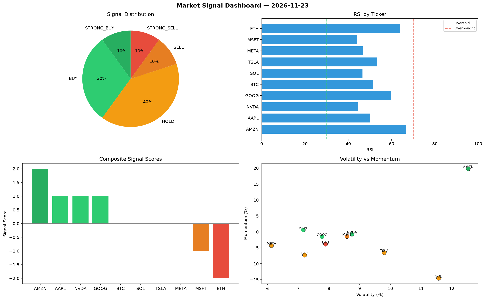

# Market Signal Report — 2026-11-23

**Run ID:** `88c4da5604` | **Buy:** 4 | **Sell:** 2 | **Hold:** 4

## Signal Dashboard

| Ticker | Price | Signal | Score | RSI | Momentum | Confidence |
|--------|-------|--------|-------|-----|----------|------------|
| AMZN | $3435.41 | **STRONG_BUY** | 2 | 66.83 | 0.1981 | 0.5 |
| AAPL | $1780.11 | **BUY** | 1 | 49.88 | 0.006 | 0.25 |
| NVDA | $1750.16 | **BUY** | 1 | 44.53 | -0.0076 | 0.25 |
| GOOG | $323.75 | **BUY** | 1 | 59.74 | -0.0151 | 0.25 |
| BTC | $4209.29 | **HOLD** | 0 | 51.35 | -0.0732 | 0.0 |
| SOL | $3608.81 | **HOLD** | 0 | 46.57 | -0.1458 | 0.0 |
| TSLA | $4092.48 | **HOLD** | 0 | 53.34 | -0.0653 | 0.0 |
| META | $254.91 | **HOLD** | 0 | 46.95 | -0.0429 | 0.0 |
| MSFT | $4562.91 | **SELL** | -1 | 44.24 | -0.0145 | 0.25 |
| ETH | $2168.77 | **STRONG_SELL** | -2 | 63.86 | -0.0388 | 0.5 |

## Delta vs Yesterday

| Ticker | Today | Yesterday | Price Change | Signal Changed |
|--------|-------|-----------|-------------|----------------|
| AMZN | STRONG_BUY | HOLD | 📈 19.44% | ⚠️ YES |
| AAPL | BUY | STRONG_SELL | 📉 -26.97% | ⚠️ YES |
| NVDA | BUY | BUY | 📉 -44.37% | — |
| GOOG | BUY | STRONG_BUY | 📉 -74.2% | ⚠️ YES |
| BTC | HOLD | STRONG_BUY | 📈 1.21% | ⚠️ YES |
| SOL | HOLD | HOLD | 📈 54.38% | — |
| TSLA | HOLD | HOLD | 📈 37.08% | — |
| META | HOLD | STRONG_SELL | 📉 -92.16% | ⚠️ YES |
| MSFT | SELL | HOLD | 📈 34.62% | ⚠️ YES |
| ETH | STRONG_SELL | STRONG_BUY | 📉 -48.8% | ⚠️ YES |