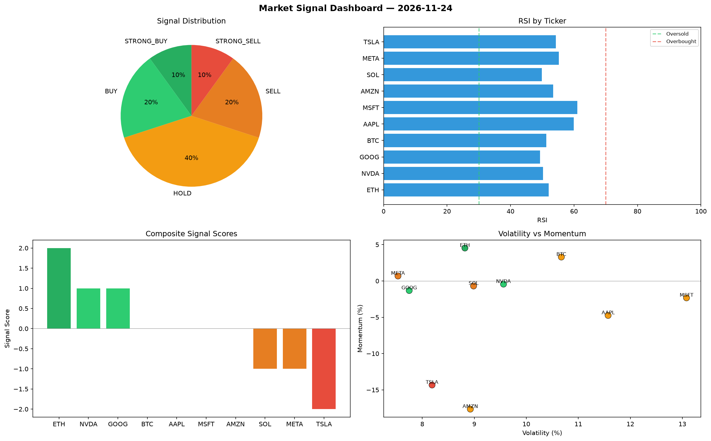

# Market Signal Report — 2026-11-24

**Run ID:** `edd7aab0d7` | **Buy:** 3 | **Sell:** 3 | **Hold:** 4

## Signal Dashboard

| Ticker | Price | Signal | Score | RSI | Momentum | Confidence |
|--------|-------|--------|-------|-----|----------|------------|
| ETH | $2503.94 | **STRONG_BUY** | 2 | 52.04 | 0.0453 | 0.5 |
| NVDA | $4183.68 | **BUY** | 1 | 50.22 | -0.0044 | 0.25 |
| GOOG | $1816.52 | **BUY** | 1 | 49.3 | -0.0132 | 0.25 |
| BTC | $1743.14 | **HOLD** | 0 | 51.28 | 0.0329 | 0.0 |
| AAPL | $1469.94 | **HOLD** | 0 | 59.93 | -0.0475 | 0.0 |
| MSFT | $792.24 | **HOLD** | 0 | 61.07 | -0.0233 | 0.0 |
| AMZN | $1437.63 | **HOLD** | 0 | 53.46 | -0.1765 | 0.0 |
| SOL | $4573.72 | **SELL** | -1 | 49.84 | -0.007 | 0.25 |
| META | $4287.39 | **SELL** | -1 | 55.21 | 0.0068 | 0.25 |
| TSLA | $2398.14 | **STRONG_SELL** | -2 | 54.29 | -0.1433 | 0.5 |

## Delta vs Yesterday

| Ticker | Today | Yesterday | Price Change | Signal Changed |
|--------|-------|-----------|-------------|----------------|
| ETH | STRONG_BUY | STRONG_BUY | 📉 -47.5% | — |
| NVDA | BUY | STRONG_BUY | 📉 -0.91% | ⚠️ YES |
| GOOG | BUY | HOLD | 📉 -62.51% | ⚠️ YES |
| BTC | HOLD | STRONG_SELL | 📉 -54.28% | ⚠️ YES |
| AAPL | HOLD | STRONG_BUY | 📉 -45.86% | ⚠️ YES |
| MSFT | HOLD | SELL | 📈 51.25% | ⚠️ YES |
| AMZN | HOLD | STRONG_BUY | 📈 55.49% | ⚠️ YES |
| SOL | SELL | STRONG_SELL | 📈 52.18% | ⚠️ YES |
| META | SELL | BUY | 📉 -0.77% | ⚠️ YES |
| TSLA | STRONG_SELL | HOLD | 📈 0.52% | ⚠️ YES |