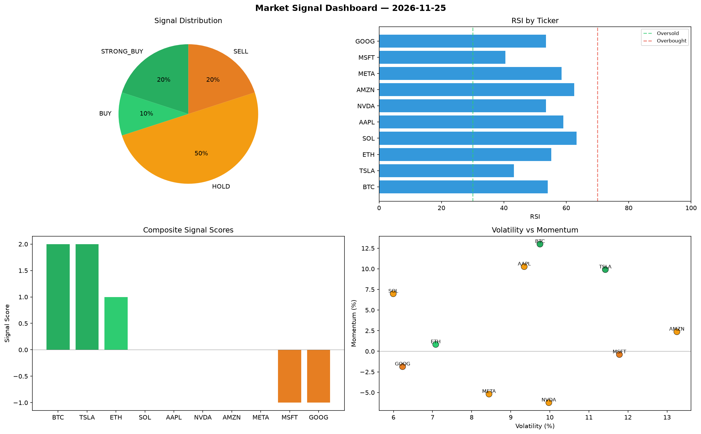

# Market Signal Report — 2026-11-25

**Run ID:** `058a16f200` | **Buy:** 3 | **Sell:** 2 | **Hold:** 5

## Signal Dashboard

| Ticker | Price | Signal | Score | RSI | Momentum | Confidence |
|--------|-------|--------|-------|-----|----------|------------|
| BTC | $514.05 | **STRONG_BUY** | 2 | 54.04 | 0.13 | 0.5 |
| TSLA | $4364.61 | **STRONG_BUY** | 2 | 43.25 | 0.0991 | 0.5 |
| ETH | $3645.03 | **BUY** | 1 | 55.2 | 0.0083 | 0.25 |
| SOL | $2368.83 | **HOLD** | 0 | 63.3 | 0.0698 | 0.0 |
| AAPL | $528.64 | **HOLD** | 0 | 59.1 | 0.1027 | 0.0 |
| NVDA | $971.94 | **HOLD** | 0 | 53.5 | -0.0623 | 0.0 |
| AMZN | $3827.98 | **HOLD** | 0 | 62.58 | 0.0237 | 0.0 |
| META | $4160.39 | **HOLD** | 0 | 58.46 | -0.0519 | 0.0 |
| MSFT | $1298.91 | **SELL** | -1 | 40.49 | -0.0039 | 0.25 |
| GOOG | $3377.8 | **SELL** | -1 | 53.53 | -0.0186 | 0.25 |

## Delta vs Yesterday

| Ticker | Today | Yesterday | Price Change | Signal Changed |
|--------|-------|-----------|-------------|----------------|
| BTC | STRONG_BUY | HOLD | 📉 -16.08% | ⚠️ YES |
| TSLA | STRONG_BUY | STRONG_BUY | 📉 -14.32% | — |
| ETH | BUY | HOLD | 📉 -24.62% | ⚠️ YES |
| SOL | HOLD | BUY | 📉 -47.54% | ⚠️ YES |
| AAPL | HOLD | HOLD | 📉 -79.26% | — |
| NVDA | HOLD | STRONG_SELL | 📉 -76.99% | ⚠️ YES |
| AMZN | HOLD | STRONG_BUY | 📈 0.42% | ⚠️ YES |
| META | HOLD | HOLD | 📈 388.05% | — |
| MSFT | SELL | HOLD | 📉 -64.04% | ⚠️ YES |
| GOOG | SELL | SELL | 📈 6433.46% | — |