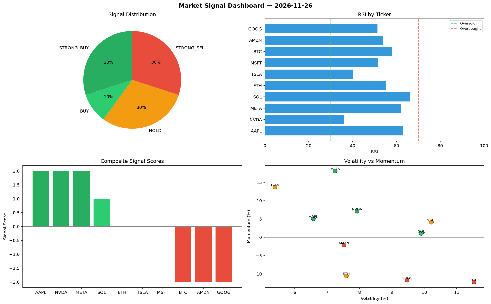

# Market Signal Report — 2026-11-26

**Run ID:** `4c5ac65e26` | **Buy:** 4 | **Sell:** 3 | **Hold:** 3

## Signal Dashboard

| Ticker | Price | Signal | Score | RSI | Momentum | Confidence |
|--------|-------|--------|-------|-----|----------|------------|
| AAPL | $1347.57 | **STRONG_BUY** | 2 | 62.84 | 0.0508 | 0.5 |
| NVDA | $607.67 | **STRONG_BUY** | 2 | 36.26 | 0.0711 | 0.5 |
| META | $272.34 | **STRONG_BUY** | 2 | 62.27 | 0.181 | 0.5 |
| SOL | $3410.97 | **BUY** | 1 | 66.27 | 0.0107 | 0.25 |
| ETH | $2193.68 | **HOLD** | 0 | 55.41 | -0.1054 | 0.0 |
| TSLA | $3366.94 | **HOLD** | 0 | 40.37 | 0.1371 | 0.0 |
| MSFT | $864.98 | **HOLD** | 0 | 51.78 | 0.0413 | 0.0 |
| BTC | $1652.75 | **STRONG_SELL** | -2 | 57.84 | -0.1222 | 0.5 |
| AMZN | $563.5 | **STRONG_SELL** | -2 | 54.02 | -0.0214 | 0.5 |
| GOOG | $2699.61 | **STRONG_SELL** | -2 | 51.37 | -0.1172 | 0.5 |

## Delta vs Yesterday

| Ticker | Today | Yesterday | Price Change | Signal Changed |
|--------|-------|-----------|-------------|----------------|
| AAPL | STRONG_BUY | BUY | 📉 -70.28% | ⚠️ YES |
| NVDA | STRONG_BUY | BUY | 📉 -43.37% | ⚠️ YES |
| META | STRONG_BUY | SELL | 📉 -50.38% | ⚠️ YES |
| SOL | BUY | HOLD | 📉 -25.45% | ⚠️ YES |
| ETH | HOLD | STRONG_BUY | 📉 -37.67% | ⚠️ YES |
| TSLA | HOLD | STRONG_BUY | 📈 283.92% | ⚠️ YES |
| MSFT | HOLD | BUY | 📉 -76.86% | ⚠️ YES |
| BTC | STRONG_SELL | HOLD | 📉 -57.31% | ⚠️ YES |
| AMZN | STRONG_SELL | BUY | 📉 -86.39% | ⚠️ YES |
| GOOG | STRONG_SELL | HOLD | 📈 54.91% | ⚠️ YES |